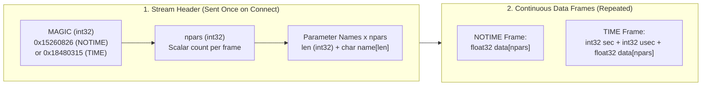

# DS-API Driver Plugins, DSP Stat Plugins & Parameter Server

Extend DS 3.x hardware acquisition, inline block statistics, or external telemetry ingest without modifying core DS binaries.

---

## 1. Custom Device Driver Plugins (`Plugin` / `PluginDev`)

DS hardware drivers are compiled as shared libraries implementing the **EDAS/DS Device Plugin API** (`core/plugin/Plugin.h`, `core/plugin/PluginDev.h`, `drivers/plugins.h`).

### Export Table & Registration

Every driver library exports a plugin descriptor table via `EDASpluginTable()` or the convenience macro `PLUGINDEV_MODULE(NAME, ...)`:

- **Magic & Versions**:
  - Plugin identifier: `PLUGIN_DEVICE = 0xEDA5A2DC`
  - Core plugin ABI: `PLUGIN_VERSION = 0x02000000`
  - Device driver ABI: `PLUGINDEV_VERSION = 0x0300`
- **Supported Device Types (`PluginDev`)**:
  - `PLUGINDEV_TYPE_ADC` — Analog/digital waveform capture device
  - `PLUGINDEV_TYPE_AMP` — Programmable signal conditioner / amplifier
  - `PLUGINDEV_TYPE_COMBO` — Combined ADC + amplifier hardware
  - `PLUGINDEV_TYPE_PARAM` — Asynchronous or polled external parameter source
- **Supported Sample Formats**:
  - `PLUGINDEV_DATA_INT16` (`2`) — 16-bit signed integer PCM
  - `PLUGINDEV_DATA_INT32` — 32-bit signed integer PCM
  - `PLUGINDEV_DATA_FLOAT32` — 32-bit IEEE float PCM
  - `PLUGINDEV_DATA_TACH` (`64`) — Tachometer / speed pulse events

### Driver Lifecycle Callbacks & Runtime Helpers

Register function pointers on `PluginDev` to participate in DS hardware discovery, setup negotiation, synchronized start/stop, and DMA FIFO streaming:

| Callback / Struct | Responsibility |
| --- | --- |
| `detect` | Probe bus/network for available devices and populate descriptors |
| `open` / `close` | Acquire OS/vendor hardware handle (`PluginDevHandle`) and tear down cleanly |
| `connect` | Validate hardware link, firmware version, and channel capabilities |
| `start1` | Phase 1 arm: configure channel gains, coupling, excitation, sample clock (`PluginDevSetup`, `PluginDevChannel`) |
| `start2` | Phase 2 arm: prefill triggers / sync lines across multi-board or multi-chassis clusters |
| `start3` | Phase 3 go: release hardware acquisition trigger |
| `run` | Acquisition worker loop pushing sample frames into lock-free ring buffers (`PluginDevFifo`) |
| `stop` | Halt hardware acquisition cleanly |
| `control` | Handle runtime control messages, asynchronous events (`PluginDevEvent`), options (`PluginOption`, `PluginAttribute`, `PluginKeyword`) |

Use the FIFO helper macros inside `run` to write acquired samples safely without dynamic allocation:
- Data push helpers: `PluginDevFifoPutW` (16-bit word), `PluginDevFifoPutL` (32-bit long), `PluginDevFifoPutF` (32-bit float), `PluginDevFifoPutE` (event)
- Flow control checks: `PluginDevFifoFull`, `PluginDevFifoEmpty`, `PluginDevFifoSkip`

---

## 2. Custom DSP Statistics Plugins (`DspPlugin` / `plugins/dbstat.c`)

Custom statistics plugins execute inline inside the DS DSP pipeline and expose new computed metrics alongside built-in block statistics (`RMS`, `Mean`, `Min`, `Max`, etc.).

### Entry Point & `DspPlugin` Interface (`DspPlugin.h`)

- **Version string**: `EDAS_DSP_PLUGIN_VERSION` = `"3.10"`
- **User Stat ID space**: Start custom statistic IDs at `DSP_STAT_ID_USERFIRST` (or unique domain IDs as shown in `dbstat.c`)
- **Plugin kinds**: `DSP_PLUGIN_RAW`, `DSP_PLUGIN_TIME`, `DSP_PLUGIN_FFT`, `DSP_PLUGIN_PEAK`, `DSP_PLUGIN_PARAM`
- **Required exported factory**: `getPlugin(int i)` returning `const DspPlugin *` for `0 <= i < count` and `NULL` past the last plugin in the shared library

### Lifecycle & Annotated `plugins/dbstat.c` Walkthrough

Each `DspPlugin` registers three hooks plus metadata:

1. **`open(const DspPluginOpenData *open)`**: Allocate per-channel state (`STATID_DBSTAT_*` selection, block size, sample rate, window/scale parameters) and return an opaque handle.
2. **`run(void *handle, const DspPluginRunData *run)`**: Process input samples/spectrum for the current block and write computed scalar result(s) back into the block's peak/stat output slot.
3. **`close(void *handle)`**: Free per-channel state allocated in `open`.

See `plugins/dbstat.c` in the SDK for a complete decibel-statistics reference implementation exporting `dbstat_open`, `dbstat_run`, and `dbstat_close` through `getPlugin(int i)`.

---

## 3. TCP Parameter Server Wire Protocol (`examples/paramserver.c`)

DS 3.x can ingest real-time external scalar telemetry from any language or embedded PLC/DAQ controller over a simple TCP socket stream using the binary **Parameter Server Protocol** implemented in `examples/paramserver.c`.

### Stream Frame Format

Upon accepting a TCP connection from DS, the server sends **one header** followed by **continuous fixed-size data frames**:



#### Step 1: Stream Header (sent once per TCP connection)

- `MAGIC` (`int32`): Protocol magic identifier:
  - `MAGIC_NOTIME` = `0x15260826`: Data frames omit timestamps; DS assigns arrival time.
  - `MAGIC_TIME` = `0x18480315`: Every data frame begins with a `(sec, usec)` timestamp pair.
- `npars` (`int32`): Number of scalar parameters transmitted per frame.
- `Parameter Names` (`× npars`): Each entry encodes `[len (int32)][char name[len]]`.
- **Byte Order**: DS automatically detects host vs. network endianness from the 32-bit `MAGIC` header!

#### Step 2: Data Frames (repeated at your telemetry update rate)

| Magic Mode | Binary Frame Layout |
| :--- | :--- |
| **`MAGIC_NOTIME` (`0x15260826`)** | `float32 data[npars]` |
| **`MAGIC_TIME` (`0x18480315`)** | `int32 sec`, `int32 usec`, `float32 data[npars]` |

### Minimal C Frame Emission Sketch (`examples/paramserver.c`)

```c
#include <stdint.h>

#define MAGIC_NOTIME 0x15260826
#define MAGIC_TIME   0x18480315

/* Send header on accepted client socket:
 *   int32_t magic = MAGIC_TIME;
 *   int32_t npars = 2;
 *   write(sock, &magic, 4);
 *   write(sock, &npars, 4);
 *   for each parameter name: write int32_t len + name[len] bytes
 *
 * Then loop sending each sample frame:
 *   int32_t sec, usec;
 *   float   values[2];
 *   if (magic == MAGIC_TIME) { write(sock, &sec, 4); write(sock, &usec, 4); }
 *   write(sock, values, sizeof(values));
 */
```
