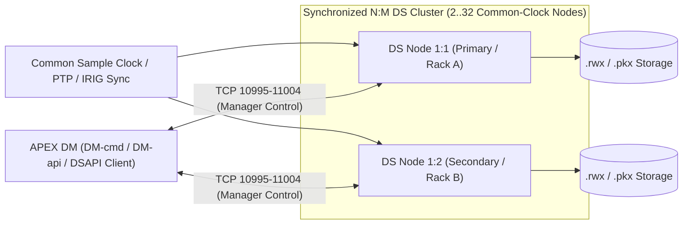

# APEX Data Manager (`DM`) & Automation Tools

**APEX Data Manager (`DM`)** provides headless, scripted, and multi-server automation for **APEX DS** acquisition systems. Through `DM-cmd`, `DM-api`, and standalone `DSAPI` command-line utilities, test-cell engineers and host test-stand computers can discover DS servers on the network, push hardware/project configurations, synchronize calibrated starts/stops across distributed chassis, and trigger data recording (`DP`) programmatically.

## Component Overview

| Tool | Interface / Role | Reference |
| :--- | :--- | :--- |
| **`DM-cmd`** | Interactive & batch command-line controller for single-server and `N:M` cluster automation scripts. | [DM-cmd Command Reference](dm-cmd-reference.md) |
| **`DM-api`** | Lightweight `DSAPI`-backed automation shell wrapping script loading and pause/control primitives. | [Automation & CLI Utilities](automation-utilities.md#dm-api) |
| **`dsdiscoverapp`** | Continuous LAN/host discovery probe listing active DS hosts, TCP ports, states, and configurations. | [Automation & CLI Utilities](automation-utilities.md#dsdiscoverapp) |
| **`dscalapp`** | Headless calibration utility that updates channel `adcCalScale` values on a running DS server. | [Automation & CLI Utilities](automation-utilities.md#dscalapp) |
| **`dsrecordapp`** | Scriptable sequence controller issuing timed Off (`O#`), Raw `.rwx` (`R#`), and Peak `.pkx` (`P#`) recording states. | [Automation & CLI Utilities](automation-utilities.md#dsrecordapp) |
| **`dscontrolapp`** | Closed-loop limit/hysteresis recorder triggering Data Points (`DP`) automatically from live channel or parameter thresholds. | [Automation & CLI Utilities](automation-utilities.md#dscontrolapp) |

## Network & `N:M` Cluster Architecture

### Discovery and Control Ports
- **LAN Discovery (UDP `10995`):** `DM` tools and `DSAPI` broadcast discovery probes on UDP port `10995` (with a `1000 ms` discovery timeout in `DSAPI_net_discover_tout`) or target a specific unicast host/IP.
- **Control & Data Streams (TCP `10995`–`11004`):** After discovery, managers establish persistent TCP sessions to control acquisition state, push configurations, subscribe to `"PR"` (Peak/Raw) telemetry, and initiate synchronized `DP` recordings. Handshake timeout defaults to `60 s`.

### `N:M` Distributed Cluster Topologies
For high-channel-count test cells spanning multiple PXI/LXI or rackmount hosts, DS servers can operate as a synchronized **cluster**:
1. **Hardware Requirements:** At least **2** and up to **32** DS acquisition systems running **identical hardware configurations** and sharing a **common reference/sample clock** (such as NI-SYNC `PXI_Clk10` / IRIG / IEEE 1588 PTP).
2. **Cluster Addressing (`N:M` Syntax):** Within `DM-cmd`, targets can be addressed globally by node index (`1`, `2`), by `host[:port]` or `host[:configuration]`, or explicitly as `N:M` cluster-node coordinates (for example `1:1`, `1:2`) when managing parallel cluster groups.
3. **Coordinated Operations:** Once clustered (`connect HOST1 HOST2 ...` or `DSAPI_net_cluster`), a single manager session controls unified `configure`, `start`, `stop`, block/DP recording (`record` / `finish`, `brecord` / `bfinish`), buffer management (`bufdisable`), and consolidated data inspection (`tabulate`).

## Licensing

DM and `DSAPI` automation workflows involve licenses on both the controlled **DS acquisition server** and, for custom standalone clients, the **controller host**:

### Modern Licensing ([APEX License Manager / `ApexLM`](../../License%20Manager/README.md))
- **DM Application & Server Flag:**
  - `DM` is registered as application `DM` in **[`ApexLM`](../../License%20Manager/README.md)** (`http://127.0.0.1:27887/`, client IPC port TCP `27884`, **APEX LM Server Daemon** ports `27885`–`27886`).
  - Each non-simulator **APEX DS** node accepting remote manager connections checks out the **`DS_MANAGER`** boolean license flag (`ds_manager`).
  - **Simulator Mode Exception:** When a DS server runs in simulated input mode (`simul`), `DS_MANAGER` checkout is waived for evaluation and script testing.
- **Standalone `DSAPI` Clients (`dsdiscoverapp`, `dscalapp`, `dsrecordapp`, `dscontrolapp`, custom apps):**
  - Standalone binaries registering as application `DSAPI` check out:
    - `APEXAPI_NET_STREAM` — network data streaming subscriptions
    - `APEXAPI_NET_RECORD` — remote `DP` recording control
    - `APEXAPI_NET_CONFIG` — remote configuration read/write and calibration control
- **DX Integration:** Running Data Manager orchestration workflows from **APEX DX** requires **`DXDM-INTEGRATION`** (`5` tokens from the `ANALYSIS` pool).

### Legacy FlexNet Licensing (`27000@host`) *(Discontinued October 2027)*
> [!WARNING]
> Legacy **FLEXlm / `lmgrd`** licensing (`27000@host`) will be **discontinued as of October 2027**. All future product releases exclusively use **[APEX License Manager (`ApexLM`)](../../License%20Manager/README.md)**.

- In legacy FlexNet deployments, the target **APEX DS** server requires the `MANAGER` (`APEXDS_MANAGER`) feature flag, and external `DSAPI` clients check out `APEXAPI_NET_STREAM`, `APEXAPI_NET_RECORD`, and `APEXAPI_NET_CONFIG`.

See also: [APEX DS Suite Overview](../README.md) · [DM-cmd Command Reference](dm-cmd-reference.md) · [Automation & CLI Utilities](automation-utilities.md) · [APEX DS Licensing](../DS/installation/licensing.md)
