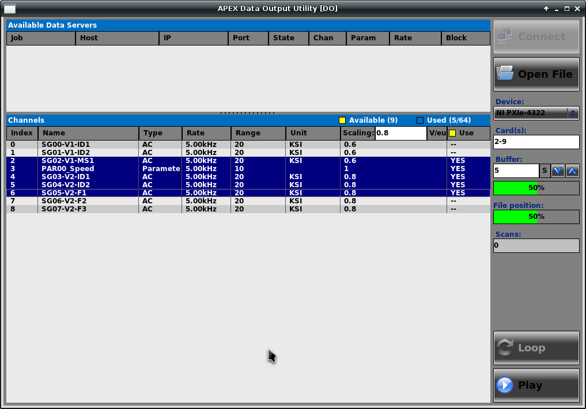

# APEX Data Output Utility (DO)

## Introduction

The APEX Data Output (DO) utility is used to generate analog output signals on supported digital to analog converter devices. The input data source can be either a previously recorded data file or a running APEX Data System (DS) server.

## Operation

The user interface of the APEX DO utility is shown on the image below. All operations can be performed on the main screen, there are no additional application windows. The image below shows the layout of the interface with an open data file. In subsequent parts of this manual a highlighted word will always correspond to the identically named element of the interface.

### Input Source

After starting the application the first task is to select the input data source. If the application detects running APEX DS systems on the network (LAN), then these are shown in the Available Data Servers section of the user interface. After selecting one of these, a connection can be established using the Connect button on the right side. Otherwise the Open File button can be used to open a data file. APEX (raw) and DATX format files are supported.

### Output Device

The DO application currently supports digital to analog converters manufactured by National Instruments on Windows (plus Contec analog output card definitions on Linux). The primary NI PXI/PXIe cards supported are:

- PXIe-4322 — 8 channels, 16 V maximum hardware output (`±10.0 V` driver range)
- PXIe-6738 — 16 channels configured in DO (32 hardware channels), `±10.0 V` maximum output
- PXIe-6124 — 2 channels, `±10.0 V` maximum output (synchronized per-card parallel tasks for high rates)
- PXI-4462 — 2 channels, `±10.0 V` maximum output (also has 2 inputs)

The card type can be selected on the Device: pull-down menu. The PXI(e) chassis slots can be selected on the Card(s): input field. This accepts a comma separated list of slot numbers or slot number ranges. Example: “2,4,6-9”. The number of available output channels depends on both the selected card type and the number of slots entered.

### Channel Configuration

The Channels section of the user interface shows the data channels available from the selected data source in a tabular format. Two columns of this table can be edited:

- The input field of the Scaling column header serves to control the generated output voltage. The scaling of the input data is done as follows: First the integer samples read from the data source are converted to engineering units (EU). The scale factor used for this conversion is obtained from the data source. (The supported input file formats or the DS data servers provide this.) The converted EU data is then scaled again to a voltage value using the conversion factor entered on this column.
- The Use column’s toggle is used to select available channels for output. The first selected channel will be connected to the first analog output, and so on. Currently there is no way to connect arbitrary data channels to arbitrary analog output channels. The number of channels that can be selected on this column is limited to the number of device channels. If the number of selected data channels does not require all available PXI cards, then only as many are used as necessary.

Editing operations are performed on one or more channels whose lines are currently selected on the table.

The table can be switched between displaying all available channels or only the currently used ones. The Available(#) and Used(#/#) radio buttons are used for this selection. The latter also shows the number of available analog out channels.

### Data Buffering

To ensure gap-less streaming the DO utility buffers a few seconds’ worth of data in memory. The size of this data buffer can be configured on the Buffer: input field. Generally, the default value of 5 seconds should be sufficient. During data replay the output device is operated from an internal sample clock that is programmed to the same frequency as the input source. The output device reads data from the memory buffer at this rate. The buffer is then filled whenever data becomes available from the input. The current fill level of the buffer is displayed under the Buffer: input field. Filling the input buffer with new data works differently in the two input modes:

- In data file input mode the buffer is pre-filled to the full level. Data replay is started only after this step. The application then monitors the state of the buffer and replaces data with new samples read from the input file as space becomes available.
- In real-time (DS network input) mode the buffer is pre-filled to its half level. Data replay starts at this point. The output device will then “pull” data from the buffer at its own rate, while the DS server network link “pushes” new data into the buffer. As the sample clocks of these two processes are approximately the same, the fill level of the buffer will stay near the half level. Eventually it will diverge from this initial value due to small differences between the input and output device sample clocks. Once the buffer becomes full or empty, it is reset to its half level. This will cause some discontinuity in the output data.

### Output Generation

Once all configuration steps described above have been completed, the data replay can be started using the Play button. This will start streaming data to the output device. The buffer fill level indicator will now be animated, it will show the fill level in real-time. The Scans: field shows the total number of data scans converted. In the data file input mode the File Position: indicator shows progress in reading the file. When this reaches the end then data conversion will either stop or restart from the beginning of the file, depending on the status of the Loop toggle button.

---

## Hardware & Interface Reference

### Supported Digital-to-Analog (D2A) Hardware

| Platform & Driver | Card Model | AO Channels Exposed | Output Voltage Ranges | Synchronization / Driver Notes |
| :--- | :--- | :---: | :--- | :--- |
| **Windows (`nidaqd2a` / NI-DAQmx)** | `NI PXIe-4322` | 8 | Driver range `±10.0 V` (16 V hardware output capability) | Addressed as `PXI1Slot<slot>/ao<ch>` via NI-DAQmx |
| **Windows (`nidaqd2a` / NI-DAQmx)** | `NI PXIe-6738` | 16 (DO table) / 32 physical | `±10.0 V` | Addressed via NI-DAQmx |
| **Windows (`nidaqd2a` / NI-DAQmx)** | `NI PXIe-6124` | 2 | `±10.0 V` | Runs separate parallel DAQmx tasks per slot synchronized via `PXI_Clk10` reference clock and `PXI_Trig0` start trigger |
| **Windows (`nidaqd2a` / NI-DAQmx)** | `NI PXI-4462` | 2 | `±10.0 V` | Combo 2 AO + 2 AI module |
| **Linux (`d2adevice` / Contec)** | `Contec DA-0818-S` | 8 | `±2.5 V`, `±5.0 V`, `±10.0 V` | Requires linking the Linux Contec `d2adevice` driver (default stub build returns `"Device not supported"`) |
| **Linux (`d2adevice` / Contec)** | `Contec DA-3218-S` | 32 | `±2.5 V`, `±5.0 V`, `±10.0 V` | Requires linking the Linux Contec `d2adevice` driver |

#### Windows NI-DAQmx Output Transfer Modes
- **Voltage mode (`<= 205 kHz`):** Writes floating-point voltages (`float64`) directly through `DAQmxWriteAnalogF64`.
- **High-speed raw mode (`> 205 kHz`):** Queries `DAQmxGetAODevScalingCoeff`, pre-scales samples to signed 16-bit integers (`int16`), disables buffer regeneration (`DAQmx_Val_DoNotAllowRegen`), and streams via `DAQmxWriteRaw` to sustain high sample rates (up to `NI PXIe-6124` throughput).

### Supported Input Files & Network Streams

| Input Source | Supported Formats / Protocol | Supported Sample Formats | Notes |
| :--- | :--- | :--- | :--- |
| **APEX Raw Files** | `.raw`, `.rwx`, `.rwz` (`FileDspEdas` / `FileDspEdasLegacy`) | `I16`, `I32`, `F32`, `RawZ`, `RawPI32`, `RawPF32` | Uses embedded channel setup, sample rate, and EU scaling coefficients |
| **DspCON DATX Files** | `.datx`, `.datx_index` (`FileDspCustomDatx` / `FileDspCustomDatxIndex`) | `I16`, `I32`, `F32`, `RawPI32`, `RawPF32` | Brick time-series playback at file sample rate |
| **Live APEX DS Stream** | Network Discovery & TCP stream (`DspNetwork`) | `RAWBIT` raw stream subscription | Live channels mirror active DS sample rate and EU scaling |

### Output Scaling, Buffering & Replay Controls

- **Slot Addressing (`Card(s):`):** Defaults to `"2-9"` and parses comma-separated slot indices or hyphenated ranges (for example `"2,4,6-9"`).
- **Voltage Scaling (`Scaling`):** Defaults to `10.0` V/EU per channel:
  - For integer formats (`I16`, `I32`, `RawZ`, `RawPI32`): `Voltage = Scaling[ch] * combinedEuA() * sample`
  - For floating-point formats (`F32`, `RawPF32`): `Voltage = Scaling[ch] * euA() * sample`
- **FIFO Buffer Sizing (`Buffer:`):** Configurable from **`1.0 s` to `20.0 s`** in **`0.1 s`** steps (default **`5.0 s`**).
  - **File Mode:** Pre-fills 100% of the FIFO before DAC start; when **Loop** is enabled, seeks seamlessly back to file start upon EOF.
  - **Live DS Mode:** Pre-fills to **50%** before DAC start and resets back to **50%** whenever clock skew causes the FIFO to exceed `100%` (overflow) or drain to empty (underflow).

### Licensing

`DO` links the APEX licensing runtime library (`CoreApexLm` / `ApexLicenser`) as part of the suite build, while the `DO` application window itself does not check out dedicated per-channel or display feature tokens. When streaming live telemetry from **APEX DS**, hardware channel and network streaming entitlements remain enforced on the upstream DS acquisition server.

See also: [APEX DS Suite Overview](../README.md) · [Hardware Device Drivers](../Drivers/README.md)
