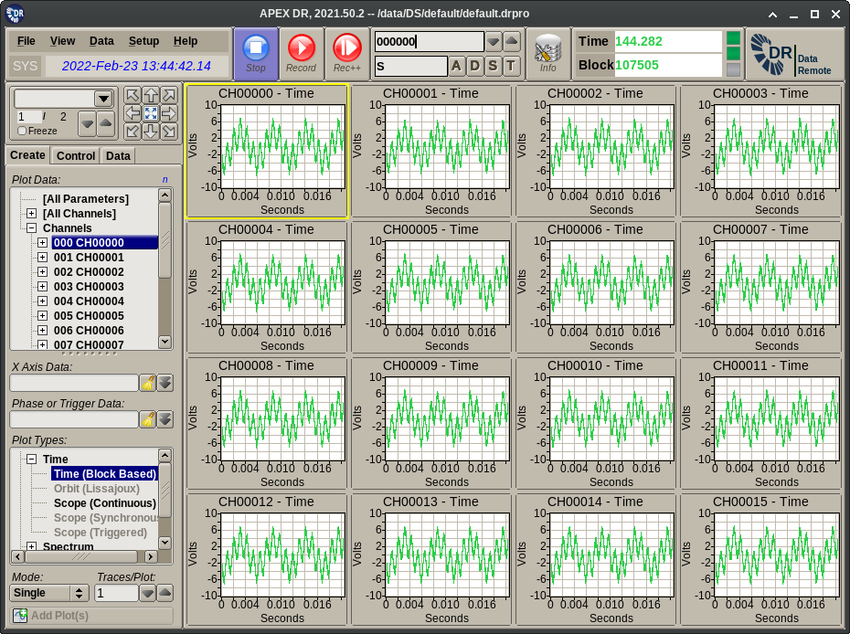

# User Interface

This Chapter describes the main user interface window of the APEX DR application.
The secondary dialog windows that may be displayed while using APEX DR will
also be covered here.

*Example APEX DR Application Window*

After launching the APEX DR application, the main user interface window
will be displayed. It has a layout similar to the one shown on the image
above. There are two major areas on the APEX DR user interface:

> - The **tool bar** area at the top of the window. This contains the main
>   application menu, various accelerator buttons and some display areas. The
>   accelerator buttons duplicate the most frequently used functions of the menu
>   for quick access. Components in this area will be explained in subsequent
>   sections.
> - The **data view** area occupies the larger bottom part of the window. It
>   can show one of several different possible views of the current data
>   monitoring session.

## Sections:

- [Menu Toolbar](menubar.md)
- [Acquisition Toolbar](recordbar.md)
- [Display Toolbar](statusbar.md)
- [Servers View](servers.md)
- [Channels View](channels.md)
- [Data Plots View](plotarea.md)
- [Preferences Dialog](preferences.md)
- [Data Point Dialog](datapoint.md)
- [Alarms Dialog](alarmview.md)
- [Licensing Dialogs](licensing.md)
