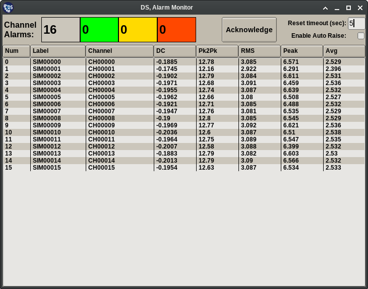

# Alarms Dialog

The Alarms Dialog is a tabular, numerical display window for channel statistics
(stat) values.  Besides showing numerical values, this dialog window also uses
color coding to indicate  whether individual stats are within their respective
limits or not.

*Example Alarms Dialog window*

The meaning of the colors is as follows:

> - **Gray**: (background) means that there are no limits defined for the given
>   stat.
> - **Green**: means that limits are defined and the stat value is below the
>   alarm levels.
> - **Yellow**: means that the stat value has exceeded the warning (i.e. reduced
>   alarm) level.
> - **Red**: means that the stat value has exceeded the its alarm level. Stats
>   that have no limits defined still  can reach this state if they exceed a
>   value computed from their monitoring limits defined during acquisition setup.

The behavior of the Alarms Dialog can be modified by the following UI elements:

> - **Alarm Reset**: a timeout can be configured that will be used to "hold"
>   "yellow" or "red" alarm indicators for the given time interval even after the
>   stat value returns to a below alarm level.
> - **Auto Raise**: when enabled it will force the Alarms Dialog to be displayed
>   and brought to the top of the window stack. Alarms that caused the auto
>   raise can be  *acknowledged*, after this only *new* alarms will raise the
>   window.
