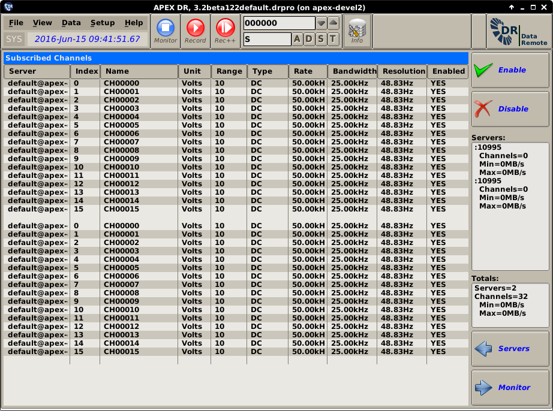

# Channels View

*Example Channels*

The channels panel's purpose is to allow users to subscribe to channels that are available on the connected servers.
Once subscribed to a channel, the channel will be available for plotting.
