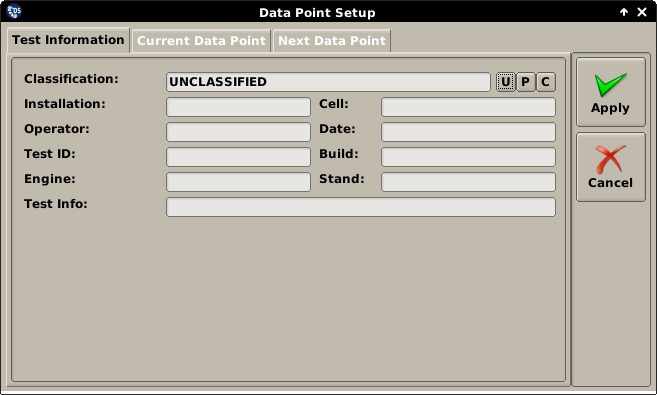
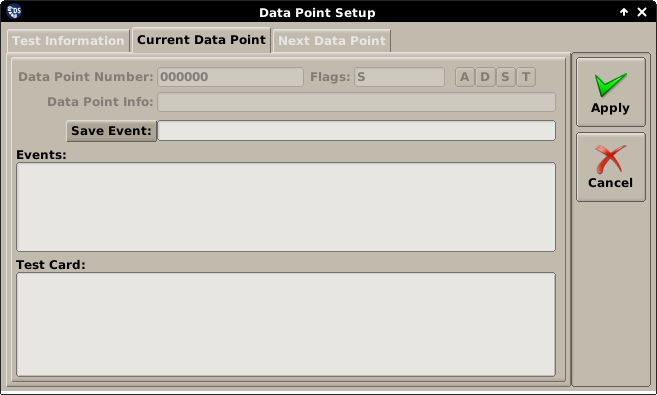
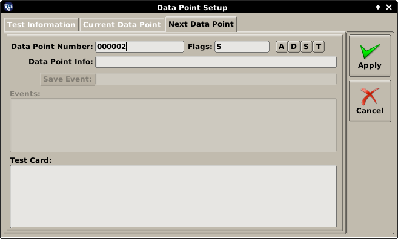

# Data Point Dialog

The Data Point Dialog allows the user to configure header information text
fields that are recorded in the data files written by APEX DR. Some of the file
header information can be changed even when APEX DR is already monitoring or
possibly even recording data, while some other inputs can be changed only when
the application is idle. The inputs are organized on different tabs within the
dialog as explained below.

## Test information

The Test Information tab allows for editing of the test information, which
typically will not change frequently. This tab is only editable when monitoring
is stopped.

*Example data point window, Test Information*

## Current Data Point

The "Current Data Point" tab shows the current data point info (Number, Flags,
Info) and allows for users to add test events to the currently being recorded
files. This tab is available only if APEX DR is currently recording data. Steps
to add test event:

> - In Save Event: entry area, type in test event. This can be any text.
> - Click "Save Event".
> - After the above steps the text will be written along with the current
> - block number to the recorded data files(s).

The "Test Card" entry area is a free form text area that allows users to add
additional test information after the data point has started. Unlike the "Test
Events" which are added as list of events to to each data file, the Test Card is
added only once to the data file. The last entry will be the only one saved to
the data file.

*Example data point window, Current Data Point*

## Next Data Point

The "Next Data Point" tab allows the user to pre-populate the Test Card entry
and adjust the Data Point Number, Flags and Data Point Info for the next
recording. This tab is always available regardless of the state of the
application.

*Example data point window, Next Data Point*
