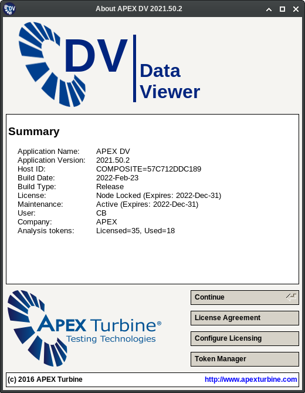
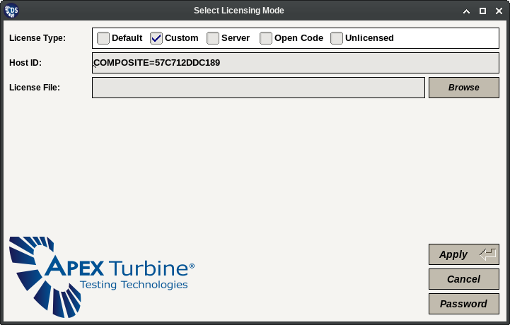
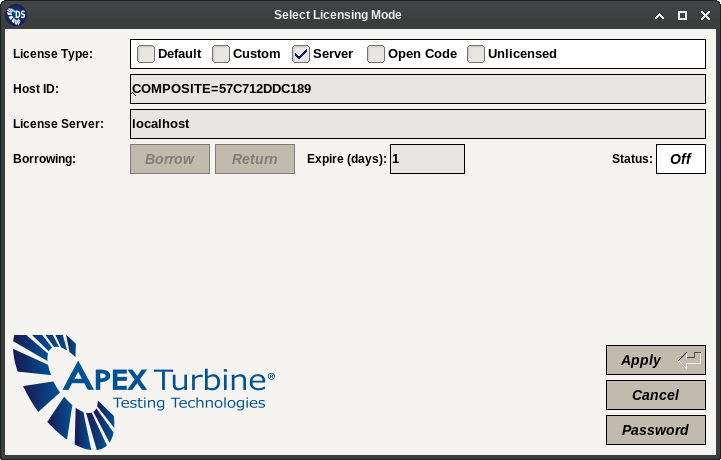
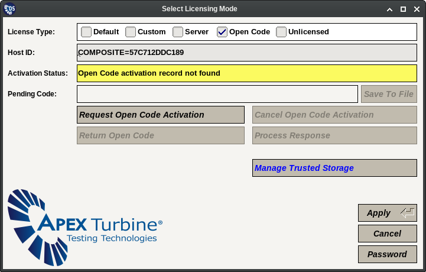
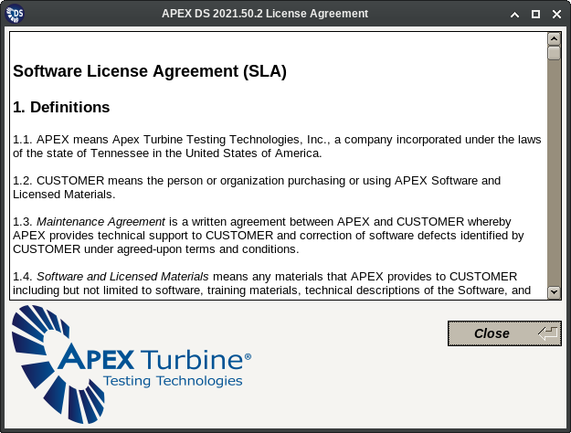

# Licensing Dialogs

When launched, one of the first initialization steps the **APEX DR** application performs is displaying the **Splash Dialog** window shown below. This window disappears automatically after a short timeout, or can be dismissed immediately when there are no licensing issues.

The Splash Dialog displays a summary of the application's version, build, and current licensing status. It can also be reopened at any time by selecting **About** under the **Help** menu.

*Example Splash Dialog (DV shown, others similar)*

## Modern ApexLM Configuration (`http://127.0.0.1:27887/`)

On builds using **APEX License Manager (ApexLM / ALM)**:

- Clicking **Configure** on the Splash/About dialog opens the **ApexLM Web Administration UI** at **`http://127.0.0.1:27887/`** in your system web browser (communicating with the local ALM client daemon on TCP port `27884`).
- Within the Web UI you can:
  - Inspect host MAC identification, active mode (`LOCAL`, `PASSTHROUGH`, or `SERVER`), and installed **`AEROPLOTS`** shared display seats.
  - Monitor live **Usage**, connected **Clients** (heartbeats), **Records**, **Logs**, and **Audit** trails.
  - Configure upstream floating ApexLM Server endpoints (`TCP 27885`/`27886`) under **Config** and request offline **Borrow** leases (up to **30 days**) under **Borrow**.
- **APEX DR** requires an active **`AEROPLOTS`** seat on startup; if no shared seat is available from the local or floating ApexLM pool, DR notifies the user and exits.

---

## Legacy FlexNet License Configuration Dialogs

In legacy FlexNet (`27000@host`) builds, clicking **Configure** opens the FlexNet License Configuration dialog shown below. Administrators may password-protect this window via the **Password** button. Selecting **Unlicensed** mode is permitted for evaluation in compatible suite utilities, though **APEX DR** requires a valid `AEROPLOTS` / DR Plot Interface seat to operate.

### Node Locked Licensing

In this mode, the APEX DR application is licensed using an APEX-provided Flexera FlexNET `.lic` file:

> - Install the software if not already installed.
> - Run the software and invoke the license configuration dialog from the initial splash screen.
> - Record the Host ID from the registration window and provide it to APEX, Inc.
> - APEX returns a `.lic` license file. Install the file according to the method selected on the license configuration panel (shown below).

*Example License Configuration Dialog: Custom mode*

Node-locked license files can be installed using one of two methods:

> - **Default**: The file must be copied to the `../licenses` directory relative to the main application executable. Keep only the active license file in this folder and remove expired files when updating.
> - **Custom**: The file can be placed in an arbitrary directory on the host OS file system. Its path must be entered in the license configuration dialog.
>
>   > [!NOTE]
>   > The two methods above may behave differently when multiple users share a workstation. **Default** generally works best across user accounts; when using **Custom**, select a directory accessible to all intended users.

### Server Based Licensing

When using FlexNet server-based licensing (`27000@host`), only the license server's IP address or hostname needs to be entered on client workstations:

*Example License Configuration Dialog: Server mode*

APEX DR supports borrowing licenses from configured FlexNet servers for up to one year, allowing disconnected operation and early return upon reconnecting.

> [!NOTE]
> Always configure the APEX application as intended for disconnected use before performing the borrow operation so the required display interface seat is borrowed properly.

### OpenCode Licensing

OpenCode is a node-locked mode using Flexera **Trusted Storage** with alphanumeric code groups (`6` to `10` groups of six characters) instead of `.lic` files:

*Example License Configuration Dialog: OpenCode mode*

APEX, Inc. maintains an OpenCode activation server supporting:

> - **Request Open Code Activation**: Generates an activation request code to enter on the activation server, creating a *pending request*.
> - **Process Response**: Applies the response code from the activation server to complete activation.
> - **Cancel Open Code Activation**: Clears a pending request locally without completing the transaction.
> - **Return Open Code**: Deactivates local APEX DR licenses and outputs a return code to reclaim credit on the activation server.

The **Manage Trusted Storage** button switches to administrative Trusted Storage actions:

> - **Install Trusted Storage**: Installs FlexNET Trusted Storage components on the host (performed only once).
> - **Trusted Storage Contents**: Lists all OpenCode licenses stored on the host.
> - **Reset Trusted Storage**: Removes all stored OpenCode licenses.
> - **Remove Open Code**: Deletes a license without generating a return transaction.
>
> > [!WARNING]
> > Except for initial Trusted Storage installation (when needed and **only once**) and listing contents, **do not** invoke Trusted Storage reset/removal actions unless explicitly instructed by APEX support.

---

## License Agreement

The License Agreement dialog is displayed when a new software release is first run and can also be opened manually from the Splash Dialog window. Users must accept the agreement text to continue using **APEX DR**.

*Example License Agreement Dialog*
