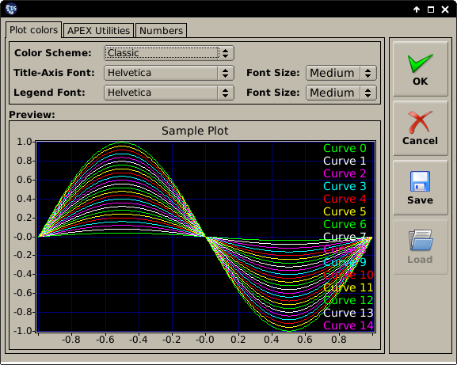
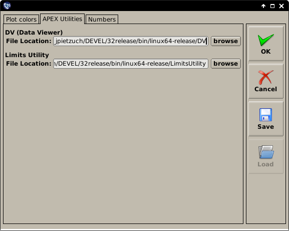
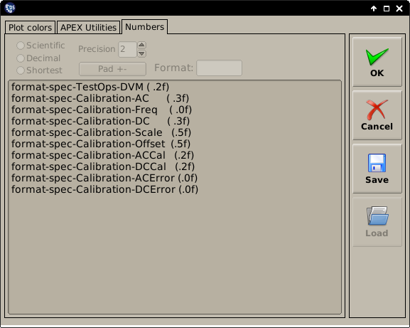

# Preferences Dialog

The Preferences Dialog allows the user to set APEX DR user interface options.
These options  are not stored in project files, therefore they are used
regardless of the currently loaded project.

## Plot Colors

Controls to allow predefined or custom color schemes. Saving a color scheme,
using "Save" button, provides a template to make a custom plot color scheme.
Once the color scheme is modified using a text editor, it can be loaded using
the "Load" button.

*Example Preferences, Plot Colors*

## APEX Utilities

Entries to set the executable path for the APEX Utilities. This will default to
the installed path and should need to be changed in non-standard installation
directories.

*Example Preferences, Apex Utilities*

## Number Formats

Global number precision formatter. Provides access to all non-plot related
number precisions.

*Example Preferences, Numbers*
