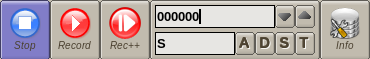
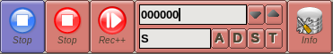

# Acquisition Toolbar

The acquisition toolbar contains several multi-function buttons and entry
fields. These replicate the functions of the most commonly used entries from the
menu bar for controlling the data monitoring and recording functions of the
APEX DR application.

*Idle or Monitoring*

The coloring of the items on this toolbar indicates the current acquisition
status. When APEX DR is in the *idle* state then all areas are colored with
the the *background color* of the user interface (typically some shade of
gray).

*Recording*

When APEX DR is in the *recording* state (i.e. when the user explicitly
triggered a recording) then the right side of the toolbar has a *red* tint.

## Acquisition Controls

This group contains several multi-function buttons. For each position the
displayed variant and the enabled or disabled status of the button depends on
the current state of the data acquisition.

> - **Monitor|Stop**:
>
>   > - **Monitor**: Starts data acquisition. This button is disabled if the
>   >   acquisition or monitoring setup is invalid.
>   > - **Stop**: Stops data acquisition. This button is disabled if there is an
>   >   ongoing recording. That recording has to be stopped first, before the
>   >   data monitoring can be stopped.
> - **Record|Stop**:
>
>   > - **Record**: Starts recording a data point.
>   > - **Stop**: Stops the current recording.
> - **Rec++**: Start or restart recording with the next reading number. This
>   button can be used both with recording on or off. If recording is active then
>   using this button will switch over to the next data file *without any gaps*
>   between the two files. This button will *increment* the displayed data point
>   number *before* starting the recording unless the user *changed* either of
>   the text entry fields since any recording control button was last used.

## Data Point Controls

This control group changes the file naming and header information of the
recorded data files. The values from the two text entry fields in this group are
typically embedded into the names of the recorded data files.

> - **Data point number entry field**: This field shows or edits the next
>   recorded data point number. The up/down arrows next to the text entry field
>   can be used to increment or decrement the displayed value.
> - **Data point tag entry field**: This field shows or edits the next data point
>   tag (or condition indicator) text. The "A", "D", "S" and "T" buttons will
>   auto populate the text entry field with some commonly used condition tags:
>   [A]ccel, [D]ecel, [S]teady State or [T]ransient.
> - **Info**: displays a dialog window that can be used to edit the various text
>   fields that are recorded in the file header of APEX format data files.
