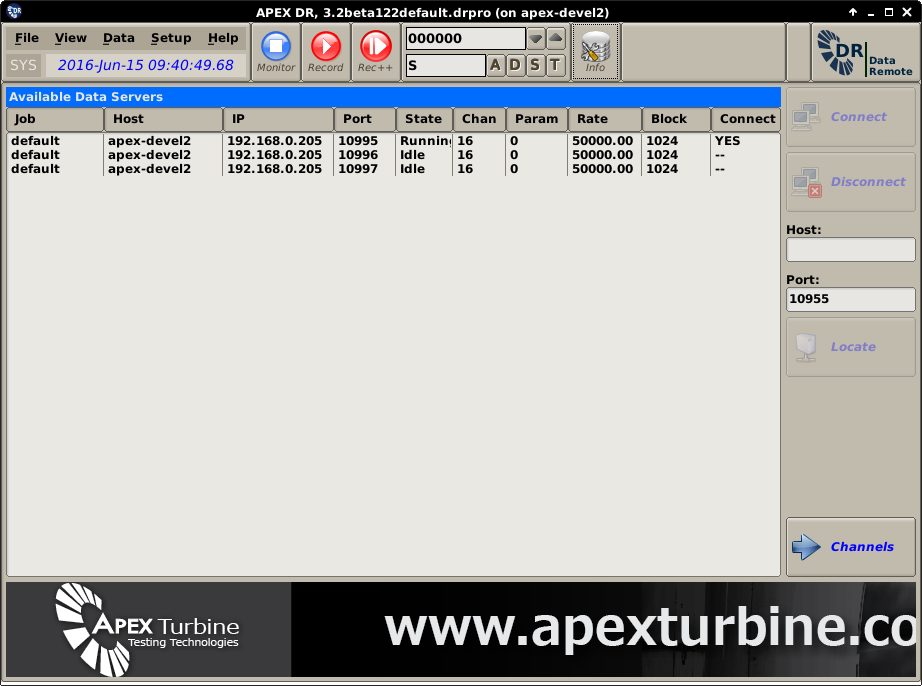

# Servers View

*Example Servers*

The servers panel's purpose is to advertise to the user what DS system are available on the network.
The DS servers advertise themselves on the network by use of a broadcast packet that is periodically sent to the network.
Connecting to a server will allow user to, using the [channels-link](#channels-link), subscribe to channels.

If a server is known to be available but for some reason does not show on the list, servers can be manually connected by using the "Host:" entry fields on the right side of the servers panel.
