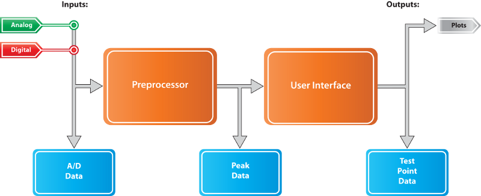
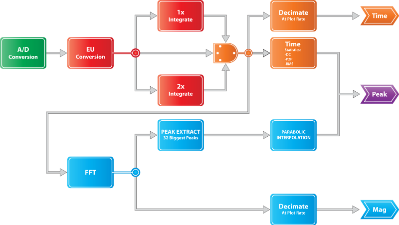

# Data Processing

Regardless of its source, the data acquired by APEX DS passes through
several processing steps before being stored and displayed. The picture
below shows the main stages of this data flow.

*APEX DS processing stages*

The different processing and storage stages may all be implemented by a
single instance of the APEX DS application, or by several networked
components.

## Channels, Parameters, Signals and Stats

These terms all describe individual data items propagated through
the stages shown above. In the rest of this Manual these terms will be
used as follows:

- **Channels** are the physical inputs of the system used to sample
  measured data. Channels can be used either as signals or parameters,
  depending on the acquisition configuration.
- **Signals** are the high speed dynamic data measurement channels processed
  and displayed by the system. Signals are always acquired and
  processed in blocks of samples.
- **Parameters** are slowly changing measurements. APEX DS acquires (or
  computes) and records a single value of these for each block of
  signal data.
- **Stats** are also slowly changing data values with one sample per
  acquisition block. But, unlike the parameters above, these are always
  associated with channels used in the "signal" role. Stats represent per block
  average values computed from the high speed samples. Examples include stats
  for DC average, peak to peak value, mean square average (RMS), etc..

## Data Blocking and Data Rates

APEX DS acquires and processes signal data in blocks of samples. This
mode of operation means that there is a fixed relationship between
various update rates in the system as explained below:

- **Sample rate** is the frequency at which APEX DS samples its input
  data, or at which the already digitized input data was originally
  sampled (when using digital inputs).
- **Block size** is the number of input *signal* samples collected by
  APEX DS into a data block for time and frequency domain processing. A
  block of data always contains a number of samples that is a power of
  2. A single value of the *parameter* inputs accompanies the signal
  data blocks.
- **Block rate** is the rate at which APEX DS processes the data
  blocks. This is equal to the sample rate divided by the block size.
- **FFT size** is the number of samples on which the FFT (Fast Fourier
  Transform) processing is done. This can be equal to the block size or
  a multiple of it (by a power of 2). If the FFT size is larger than
  the block size, APEX DS performs *overlapped* FFT-s on each input
  data block by joining it with the necessary number of adjacent blocks
  to collect the required number of samples. This means that in
  overlapped mode each data sample is processed multiple times.
- **Plot refresh rate** is the rate at which the plots are redrawn on
  the APEX DS graphical user interface. This can be as high as the
  block rate, but the user interface may perform redraws slower if the
  performance of the graphics hardware is insufficient.

## Multiple Sample Rates

APEX DS supports data acquisition at different sample rates by providing
per channel over-sampling or down-sampling in steps that are powers of 2
between 1/16 and 16. Note that most supported acquisition devices do not
have the hardware features necessary to provide independent sample rates
on on a per channel basis. This means that in most applications the oversample
of down-sample ratios must be set the same for all channels of a single
device. However, multiple sample rate configurations are still possible
if the system contains more than a single acquisition device.

## Processor Data Flow

The data processor of an APEX DS acquisition system processes data
according to the flow chart below.

*APEX DS signal processing data flow*

Channels are continuously sampled by the *A/D Conversion* process and samples
are grouped into data packets for each block. The *EU Conversion* (Engineering
Unit Conversion) stage scales the input data using coefficients established
during acquisition setup, and produces the time domain data packets propagated
to the APEX DS user interface. This stage can optionally perform integration or
differentiation on the input signal too. The scaled data packets are also used
as inputs to the spectral analysis phase of the data processing. This involves
performing an **FFT** (Fast Fourier Transform) on the data and extracting the
biggest frequency domain peaks. The extracted peaks are further enhanced by
performing *parabolic interpolation* on them. This process will generate
*enhanced spectrum peaks* up to an user configured maximum count. However, the
final count may be lower depending on processing thresholds and the actual input
data.

Alternatively, some channels may be processed as parameters. This means
computing a single scalar value from a block's worth of high speed input
samples. There are different ways this processing can occur:

- **Regular Parameter** values are computed as the DC average of the input
  block's samples.
- **Speed Parameter** values are computed by comparing the input samples to a
  threshold value in order to detect the location of *tachometer pulses* in the
  input. The average distance between the detected pulses will then be
  converted to a rotational speed (RPM) value. For channels used this way the data
  processor also generates outputs that represent the location of the detected
  pulses. Speed parameter processing has several user configurable options.
- **IRIG Time Code** channels are processed by assuming that the input samples
  are from a 1kHz carrier IRIG-B 120 waveform. If a valid time code signal is
  detected then the resulting time code value is used to time tag all input
  data for the current block.

## Optional Processing Steps

As shown on the image in the section above, there are various stages of the data
processing where it is possible  to insert optional processing steps. This is
done by adding one or more *plugin* modules to the processing chain via an
interpreted  text line inserted into the APEX DS data processor configuration.
Plugins can be inserted at one or more of the following stages:

- **Raw Plugins** work directly on the incoming raw input data before anything
  else. They can generate updated raw samples that will replace the original
  input for the purposes of further processing. Unlike plugins at later stages,
  raw plugins may require access to *overlapped* data. This means that raw
  input data from the previous and next blocks will also be available for
  computing the updated raw samples of the current block. Typical use cases of
  raw plugins include FIR filters, spike filters, etc..
- **Time Plugins** work on time domain samples after the EU conversion step.
  They can generate updated time domain samples that will replace the original
  input for the purposes of further processing. Typical use cases of time
  plugins include IIR filters, defining and computing "non standard" stats, etc..
- **FFT Plugins** work on the final results after all "standard" processing
  steps are done. They can only define and compute additional stat values or
  update the status flags of the extracted FFT peaks. Typical use cases of FFT
  plugins are noise tagging filters.
- **Peak Plugins** are essentially the same as the FFT plugins above. The only
  difference is that they do not require access to processed time domain or FFT
  samples, only to the extracted peak data. This makes them usable in some
  situations where the full per block data set is not available.

> [!NOTE]
> Channels processed as parameters or IRIG time codes will **only** execute
> their raw plugins.

## Duplicated Channels

The APEX DS data processor allows duplicating any of its input channels in order
to process  the secondary copy with different settings. Additionally, duplicate
channels themselves can be duplicated again. There is no limit on the number of
duplicates created from any channel. Duplication can occur at any of the
following four stages:

- At the raw input data stage.
- At the raw data stage after any raw plugins.
- At the EU converted time domain stage before any time plugins.
- At the EU converted time domain stage after any time plugins.

Any step in the "regular" processing sequence that follows the stage of
duplication will be performed and be fully configurable in the context of the
duplicated channel.

> [!NOTE]
> There are certain duplicated channel combinations that are invalid. These are
> listed below:
>
> - Duplicating a channel marked as "unused".
> - Duplicating a channel used as IRIG or parameter at either one of the "time" stages.
> - Using a channel duplicated at either of the "time" stages as IRIG or parameter.
> - Adding raw plugins to a channel duplicated at the raw plugin stage from its source.
>
> Duplicate channels will "inherit" their source channel's sample rate.

## Computed Channels or Parameters

The third way new non-input signal channel or parameter items can be defined in
APEX DS is to specify them as the result of some arithmetic expression. The
operands of these expressions can be constants, parameter values, signal
channels or their stats. Parameter expressions are evaluated on scalar values
where channel operands are replaced with their per block average. Signal channel
expressions are evaluated at the sample rate equaling that of their highest
sample rate channel operand.

> [!NOTE]
> The value used for channel operands of the "compute" expressions is always
> the final result of the time domain processing, i.e. the output of the "time
> plugin" stage.
>
> Computed channels can be duplicated too!
>
> Computed channels can only be used in the "signal" role, it is not possible
> to process them as IRIG or parameter.

## Processing Delay

Some of the processing steps described above require access to earlier and later
data blocks in order to compute the current one. The processing delay and the
total number of blocks required before a single output block is produced are
the sum of the following two requirements:

- **Raw Plugins** may require one previous and one future raw data block.
- **Overlapped FFT** processing requires N/2 past and future EU processed
  data blocks for an overlap of N. For example, an overlap of 8 will require 4
  past and future blocks besides the current one.

These data block buffering and delay requirements will manifest in different
ways in members of the DS application suite. In APEX DS the processing delay
will contribute to the delay between when a sample was acquired and when it can
be monitored on the user interface. In APEX DV the playable range of the input
file's blocks will be "trimmed" on both ends by the required total
processing overlap.

## Data Packets

The data resulting from the above processing steps is split into several separate
sequences of data packets:

- **Raw Packets** are unmodified copies of the input data. These are
  not sent to the user interface, but can be optionally recorded.
- **Time Packets** contain the input data scaled in engineering units.
  The stream of these packets may be decimated before storage by using
  only every Nth packet.
- **Magnitude Packets** contain the absolute value of the FFT results.
  The stream of these packets may be decimated before storage by using
  only every Nth packet.
- **Peak Packets** contain summary data for each data block. These
  include time domain statistics such as peak to peak and RMS values
  and the extracted and parabolic interpolated FFT peaks. These packets
  are all stored and propagated to the user interface to guarantee that
  the displayed top responses are always accurate.
- **Parameter Packets** contain once per block values. These can be
  computed from channels that are configured as parameters or received
  from external sources. These packets are all stored and propagated
  to the user interface to guarantee that the parameter histories are
  always accurate.

Various combinations of these packets are stored in different versions of the
data files that can be recorded and replayed by the applications of the APEX
DS suite.
