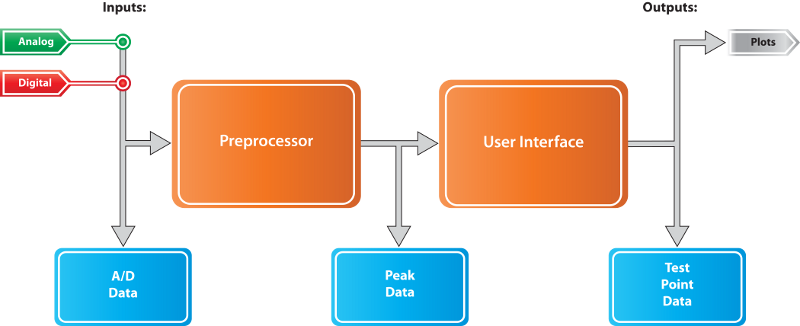

# Data Storage

As shown on the figure below, data can be stored at various
stages of the acquisition and processing sequence performed by APEX DS. Data
files recorded at different stages have different characteristics.
Generally, any data generated at a later stage can be reproduced from
"upstream" files in case it was not recorded at acquisition time or if
it needs to be recalculated with modified processing settings.

*APEX DS data storage stages*

## Raw Data Storage

Data recorded at this stage contains the input samples received from the
ADC device or digital input. The data is not processed in any way before
being recorded. The raw data files have the following content:

- Complete acquisition setup information.
- Raw data packets.
- Parameter data packets.

Storing raw data requires the most disk space, but it is also the most versatile
form of recording. Raw data can be reprocessed with different processing
settings. APEX format raw data files typically have the ".rwx" extension. There
are some compressed or packed data formats available, these are usually recorded
with the ".rwz" extension.

## Peak Data Storage

Peak data is recorded at the end of the data processing stage described earlier.
Data files recorded at this stage contain:

- Complete acquisition setup information.
- Parameter data packets.
- Peak data packets.
- Time packets, at a possibly decimated rate.
- Magnitude packets, at a possibly decimated rate.

Storing peak data may require less disk space than raw data, but it is also less
flexible. When replaying peak data it is still possible to perform different
types of analysis, to display the data on various types of data plots, etc.
However, it is no longer possible to change the data processing options or to
reproduce missing time or magnitude packets if these were recorded at a
decimated rate. APEX format raw data files typically have the ".pkx" extension.

## Storage Modes

A running APEX DS data acquisition system operates in one of the two
following data recording modes:

- Data point (or test point) mode means that the system is recording data into
  a user specified data file. Typically this mode is used when some important
  event needs to be recorded during testing.
- Monitoring mode means that the system is acquiring, processing and
  displaying data, but it is not recording an important test event.

In monitoring mode (i.e. when no data points are recorded) APEX DS may or may
not record raw and peak data, depending on how it is configured. If data
recording between data points is enabled, one of the following two buffering
mechanisms can be used:

- In continuous buffering mode DS will write sequentially numbered data
  files which are not deleted. However, these monitoring mode files will
  be written into a different, user configurable directory.
- Circular buffer mode is similar to the continuous mode above. However, the
  total amount of monitoring mode data will be limited to a user specified time
  limit.  Any buffered data older than that will be removed, ensuring that the
  total amount  of monitoring data (possibly split between multiple files) does
  not exceed the specified total time.

In either case, each type of data (raw and peak) is recorded into a single file only
(data point or buffer) at any given time. That is, turning on a data
point recording will stop data being recorded in the (circular or
continuous) buffer, and turning off the data point will resume writing
the data into the buffer.

## Data File Formats

The default storage format for raw and peak data is the APEX native file
format. This file format has provisions for storing the complete APEX DS
acquisition configuration, so files can be replayed using the same
settings they were recorded with. The raw and peak file formats are
identical, the only difference between them is the type of the data
packets they contain.

APEX DS can optionally store raw data in the DATX format. This feature
was provided for compatibility with some 3rd party tools used for data
analysis. Note that only raw data can be stored this way, the DATX
format does not support processed (peak) data. Using the DATX format
involves some trade offs:

- The DATX format has no provisions for storing the complete APEX DS
  acquisition and processing setup. Some aspects of the acquisition setup
  (channel names, scale factors, units, etc.) can be stored, but many others
  (channel usage, plugins, FFT settings, duplicated and computed channel
  specifications, etc..) will be lost when using this format.
- The DATX format has no provisions for storing parameter data. This is
  typically not an issue for parameters computed from ADC data channels – as
  long as the APEX DS setup is preserved using means other than the DATX file.
  However, parameters acquired using some other mechanism (merged from low
  speed data files or network interfaces) will not be stored.

Therefore, the recommended format for raw data recording is the APEX
native format, unless DATX compatibility is required for analyzing data
using external tools.

## Exporting Data

The APEX DS user interface can export several different types of processed
data files containing final result data. The main categories for these
files are:

- The contents of data plots shown on the application's user interface can
  be exported in various image or document file formats (PNG, PPTX, etc..).
- Plot data dump files can be generated from individual data plots.
  These files are written in the CSV (Comma Separated Value) format.
- Various parts of the current acquisition or processing project can be
  exported. These include channel or parameter configuration files,  monitoring
  limits, plot screen configurations, etc.. These exported project components
  are typically saved in the CSV format, and can be imported into other APEX,
  Inc. tools,

These exported files are typically small (compared to raw or
peak files) as they contain highly reduced data.
