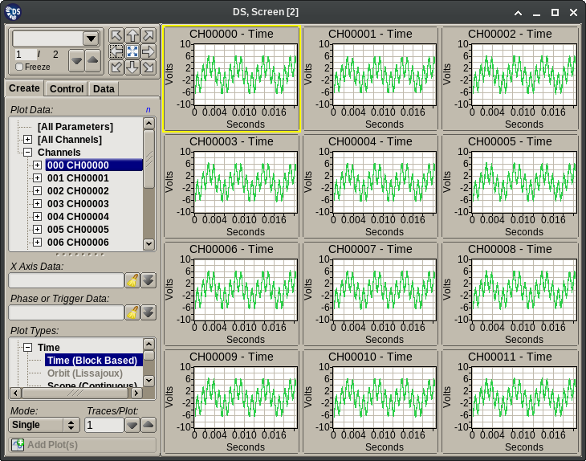
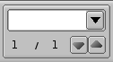
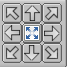

# Plot Area

The Plot Area is comprised of two main parts. The right side contains a grid for
locating data plots. The left side of the Plot Area contains various controls to
populate, manipulate and interrogate plots on the grid.

*Example Plot Area (shown in a secondary plot window)*

The grid in the simplest case is contained entirely on a single page. If the
grid density is decreased (fewer plots on page), the grid cells with plots that
no longer fit on the page are automatically added to additional pages. Returning
the grid to the original density will pull the plots back from the additional
pages. The grid and page system is a continuous flow of cells/plots that spans
multiple pages as the density of the grid changes on a given page. **Page
break** markers are also supported, these can be added to protect the starting
plot and layout of pages where this is desired. In summary, the plot placement
and page break mechanisms work in a way that is analogous to a word processor.

## Page Selector

The Page Selection controls have two functions. First using the **Up** and
**Down** arrow buttons user can index through the pages. Pages are automatically
created as the user exceeds the last page.

The second function of the controls is to allow the user to name pages. By
default no pages are named. To name a page navigate to it, then type '('
followed by the desired page name and ')' in the text entry box. This will add a
named page break before the first plot on that page. Once pages are named, they
will become available choices in the adjacent pull-down menu. Page names and the
associated page break markers can be removed by typing an empty pair of ()-s.

The Page Selection control also shows the maximum number of pages that exist
and the current page. In the example this is show as *1 / 1*. This indicates as
*Current Page / Last Page*. The current page can be changed by typing a number
in the widget, this will select the new page based on the page index entered. If
the entered value exceeds the current maximum number of pages, new pages are
added up to the number entered.

## Grid controls

The Grid Sizer provides the controls to change the grid density. The center
button will zoom the selected plot to the full size of the grid area, clicking
the center button a second time will return the plot to its original location in
the grid.

> - The **Up Arrow** adds one row to the bottom of the grid.
> - The **Down Arrow** removes one row from the bottom of the grid.
> - The **Left Arrow** removes one column, the plots are reorganized to maintain their flow.
> - The **Right Arrow** adds one column, the plots are reorganized to maintain their flow.
> - The **Upper Right Arrow** adds one row and adds one column.
> - The **Lower Left Arrow** removes one row and removes one column.
> - The **Upper Left Arrow** adds row and removes column.
> - The **Lower Right Arrow** removes a row and adds a column.
> - The **Center** button toggles a single selected plot between zoomed and unzoomed states.

> [!TIP]
> Rows, Columns Cells and Plots can be deleted by right clicking on the
> Plot Grid and accessing the 'Delete' menu.
