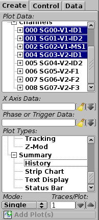

# Plot Creation

The Create Tab is one of the possible views of the left side control area.  It
provides the controls to select plot data items and plot types and place them on
the plot grid. Plots will be created starting at the selected plot grid cell and
will **overwrite** existing plots starting at that position.

> - **Plot Data:** provides a tree of all channels and parameters. Channels are
>   expandable, once expanded the list of
>   available stats will be visible. This control also provides '**All Channels**'
>   (also expandable) and '**All Parameters**' choices that allow quickly selecting all
>   items of the respective type.
> - **X Axis Data:**  provides a list and current selection of the optional X Axis Data.
> - **Phase or Trigger Data:**  provides a list and current selection of the optional Phase or Trigger data.
> - **Plots Types:** provides a list of all available plot types.
> - **Mode:** *Single* is the traditional plot placement mode where selecting a plot type immediately creates the matching plot on the plot grid.
> - **Mode:** *Multiple* is a delayed plot creation mode which allows the selection of multiple plot types before placing them on the grid.
> - **Traces/Plot:** indicates that if multiple channels or parameters are selected put this number of data items on each plot.
> - **Add Plots(s)** is active when in the Multiple plot creation mode. Clicking this will place the selected plots on the grid.

### Create Single Plot

1. Select the desired cell position in the grid. The selected cell will have a border drawn around it.
2. Using the **Plot Data** tree browser select a single channel, parameter or stat.
3. Optionally, select the desired X axis data and phase/trigger data items.
4. Using the **Plot Types** tree browser expand the desired plot category.
5. Click on the desired plot type. This will create and place the selected plot type in the marked cell on the grid.

### Create Identical Plots for Multiple Data Selections

1. Select the desired cell position in the grid. The selected cell will have a border drawn around it.
2. Using the **Plot Data** tree browser select multiple channel, parameter or stat items.
3. Optionally, select the desired X axis data and phase/trigger data items.
4. Using the **Plot Types** tree browser expand the desired plot category.
5. Optionally, adjust the **Traces/Plot** control to define how many data traces will be created on each new plot.
6. Click on the desired plot type. This will create and place plots of the selected type starting at the marked cell on the grid.

### Create Multiple Plot Types for a Single Data Selection

1. Select the desired cell position in the grid. The selected cell will have a border drawn around it.
2. Using the **Plot Data** tree browser select a single channel, parameter or stat.
3. Optionally, select the desired X axis data and phase/trigger data items.
4. Using the **Mode** drop-down, select **Multiple**.
5. Using the **Plot Types** tree browser expand the desired plot category or categories.
6. Click on each desired plot type while holding down the '*Control*' key.
7. Click on **Add Plot(s)**. This will create and place the selected plot types starting at the marked cell on the grid.

### Create Multiple Plot Types for Multiple Data Selections

1. Select the desired cell position in the grid. The selected cell will have a border drawn around it.
2. Using the **Plot Data** tree browser select multiple channel, parameter or stat items.
3. Optionally, select the desired X axis data and phase/trigger data items.
4. Using the **Mode** drop-down, select **Multiple**.
5. Using the **Plot Types** tree browser expand the desired plot category or categories.
6. Click on each desired plot type while holding down the '*Control*' key.
7. Click on **Add Plot(s)**. This will create and place the selected plot types for all selected data items starting at the marked cell on the grid.
