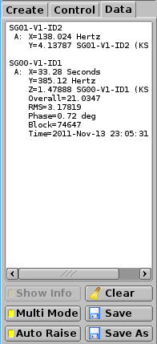

# Plot Cursors

The Data Tab is the third possible view of the left side control area.

The purpose of this tab is to show detailed information about cursors placed on
one or more plots of the current plot page. The text Area will display
dynamically updated readings from all cursors. The controls near the bottom of
the tab serve the following functions:

> - **Clear:** Remove all cursors from plots on the current page.
> - **Multi Mode:** If enabled, allows multiple cursors to be placed on individual plots.
> - **Auto Raise:** If enabled, auto switch to this tab when a cursor is placed on a plot.
> - **Save:** Save (append) the displayed text to the last selected output file.
> - **Save As:** Save the displayed text to a newly selected data file.

The Data Tab will **only** display cursors from plots on the current page. When
switching pages the contents of the tab will change. However, plots do remember
their cursors even when invisible, so switching back to a previous page will
restore the cursors from that page's plots.

The actual text displayed for each cursor depends on the plot type. In all
cases the X and Y coordinates of the selected data point parameter present, but
in some cases more information will be provided.
