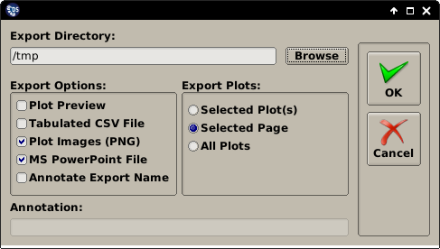

# Plot Export

The Plot Export dialog is accessed through the 'Export' sub-menu in the
[File Menu](../interface/menubar.md#file-menu) of the APEX DR application. It can also be accessed from
the  right click [plotmenu-link](#plotmenu-link) invoked over a selected plot.

*Example plot export window*

This dialog supports exporting the contents of selected data plots in a variety
of formats. For each export operation a new sub-directory will be created under
the user defined base export folder. The name of this new sub-directory will
include the time stamp of the export operation and an optional user defined
annotation text. The export options that can be configured on this dialog
include:

> - **Export Directory:** Base file system path to store exported files.
> - **Export Options:** This selects the output options.
>
>   > - **Plot Preview:** Show a preview of the first exported plot in a pop-up window. This is only supported for the CSV text export mode.
>   > - **Tabulated CSV File:** Export plots to CSV format text file(s).
>   > - **Plot Images (PNG):**, Export plots to PNG format image file(s), one image for each plot.
>   > - **MS PowerPoint File:**, Export temporary PNG image files, then combine them in a PPTX format presentation, one image per slide.
>   > - **Annotate Export Name:** Enables adding user supplied text to the export directory name.
> - **Export Plots:** This selects the plots whose contents will be exported.
>
>   > - **Selected Plot(s):** Export only plots that are selected on the current page.
>   > - **Selected Page:** Export all plots that are on the currently visible page.
>   > - **All Plots:** Export all plots from all pages.
> - **Annotation**: User supplied text that will be prepended to the export directory name (if enabled).
