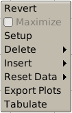
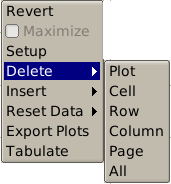
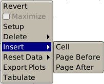
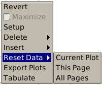

# Plot Menu

The plot menu is available by right clicking over a plot cell. Depending on the
the contents of the cell (empty or not, type of the plot)  menu items may be
visible, hidden, enabled or disabled. Some plot types also may add  entries to
the menu, these will be described in their respective sections. The menu choices
that are always present include:

**Setup**

> Invoke the Plot Setup dialog initialized with the settings of the selected
> plot. This dialog will be described in the next section.

**Revert**

> Restore the default plot scaling settings on the selected plot(s).

**Maximize**

> Maximize or restore the currently selected plot to the entire plot area. This
> duplicates the function of the center button of the plot grid controls.

**Delete**

> The choices available under this sub-menu allow the user to remove plots or
> pages from the plot area:
>
> > - **Plot:** Delete selected plots. This leaves grid cells intact.
> > - **Cell:** Delete selected cells. This will change the the plots
> >   assigned to grid cells and possibly 'pull' plots from the next page
> >   to the current one.
> > - **Row:** Delete selected row. This does not change the layout of
> >   subsequent pages.
> > - **Column:** Delete selected column. This does not change the layout of
> >   subsequent pages.
> > - **Page:** Delete current page and plots
> > - **All:** Delete all pages and all plots

**Insert**

> This sub-menu contains the following choices:
>
> > - **Cell:** Insert an empty cell at currently selected grid location. This will change the the plots
> >   assigned to grid cells and possibly 'push' plots from the current page
> >   to the next one.
> > - **Page Before:** Insert a new page before the current one. This does not change the layout of
> >   the current and subsequent pages.
> > - **Page After:** Insert a new page after the current one. This does not change the layout of
> >   the current and subsequent pages.

**Reset Data**

> This sub-menu contains the choices listed below. Plots meeting the definition
> of the *compatible* criteria have the same or similar type as the selected
> plot.
>
> > - **Current Plot** Remove all buffered data from the currently selected plots.
> > - **This Page** Remove all buffered data from all compatible plots on the current page.
> > - **All Page's** Remove all buffered data from all compatible plots.

**Export Plots**

> Displays the [plotexports-link](#plotexports-link) dialog that allows saving the contents of
> selected plots to PNG images, text files or PPTX format presentations. The
> dialog provides choices to export from the selected plots, current page or all
> plots. Full details are in the [plotexports-link](#plotexports-link) section.

**Tabulate**

> Convert plot's data to CSV formated text and display it on a pop-up dialog
> window, From there Ctrl-C can be used to copy and paste into a text editor or
> other office tool.
