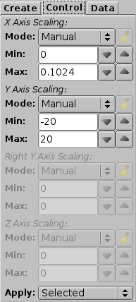

# Plot Scaling

The Control Tab is the second possible view of the left side control area.

The tab is provided as a convenience, it allows quick access to all plot axis
scaling on the selected plot(s) without having to invoke the full [plotsetup-link](#plotsetup-link)
dialog. It provides the following controls for each active axis of the selected
plot(s):

> - **Mode: Manual** Use Min Range: and Max: to set axis scaling (default).
> - **Mode: Auto** Automatically rescale the axis min and max to fit the currently visible data.
> - **Mode: Auto Hold** Similar to the above option except never decrease the min or max values, i.e. it is a peak hold.
> - **Min:** First value from the left appearing on the axis.
> - **Max:** Last value from the left appearing on the axis.
> - **Apply: Selected** Apply all changes made to axes of selected plots.
> - **Apply: Page** Apply all changes made to all matching type plots on the current page.
> - **Apply: All** Apply all changes made to all matching type plots on all pages.

The active axis control groups are determined by the type of the currently
selected plot.
