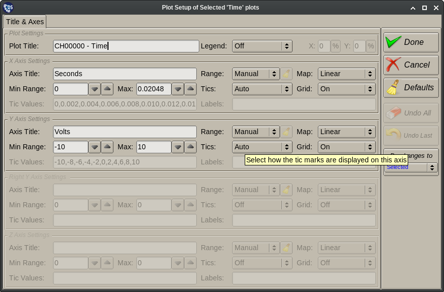

# Plot Setup

The Plot Setup dialog can be invoked by right clicking over the desired plot and
selecting the **Setup** menu choice. This is a tabbed dialog, the number of
pages that will be available  depends on the type of the plot being configured.
Between these, the Plot Setup dialog will allow the user  to edit all
configurable options of each plot type. This section describes the first page of
the dialog that is common for all plot types.



*Example Plot Setup dialog*

The stack of buttons on the right side of the dialog provides the following functionality:

> - **Done:** Close the Plot Setup window, any changes to plots are committed.
> - **Cancel:** Undo all changes and close the Plot Setup window. Closing the window on the window frame has the same effect.
> - **Defaults:**: Reset all plot settings to their default values. These are the settings with which the plot was originally created.
> - **Undo All:** Remove all changes made to all selected plots since the Plot Setup window was originally opened.
> - **Undo Last:** Remove the last change made to all selected plots made on the Plot Setup window.
> - **Do Changes:** This pull down controls the set of plots to which changes on the dialog will be applied. Choices are:
>
>   > - **Selected:** Apply changes only to the selected plot(s).
>   > - **Page:** Apply changes only to all compatible plots on the current page.
>   > - **All:** Apply changes only to all compatible plots on all pages.

The inputs at the top of the page control the title and legend drawing options
of the plot. The title is the text displayed at the top  of the plot between the
inner and outer frames. The legends are color markers drawn inside the data area
of the plot, they are used on plots with multiple data curves to identify them.
Legends can be disabled, placed at either corner of the plot, or at an user
defined custom position.

The rest of the dialog page contains four identical groups of controls for each plot axis
(X, Y, second Y axis on the right and Z). Depending of the selected plot type some of these
groups will be deactivated. Controls available for each axis include:

> > - **Axis Title:** The text that will be drawn next to the axis. Typically this is the name of the data item, its units or both.
> > - **Range:** Pull-down menu for selecting the data range that will be used to compute the coordinate mapping for this axis. Choices are:
> >
> >   > - **Manual:** Use the manually entered min/max values (default).
> >   > - **Auto:** Establish the range dynamically from the displayed data.
> >   > - **Auto Hold:** Grow the range dynamically based on the displayed data, but never shrink it. The small '*clear*' button next to the pull-down can be used
> >   >   to reset the range.
> > - **Min/Max Range:**: Axis range entry fields for the manual range mode only.
> > - **Map:** Pull-down menu that allows the user to select between linear and logarithmic coordinate mapping.
> > - **Tics:**: Pull-down menu controls the drawing of axis tic marks on the outside of the inner plot frame. Choices are:
> >
> >   > - **Off:**: No tic marks are drawn.
> >   > - **Auto:**: Tic mark positions are computed automatically from the axis range.
> >   > - **Custom:**: Tic marks are drawn at user given positions with user given labels.
> >
> > - **Grid:** This controls how the tic marks (if any) are extended to the inside of the
> >   plot's inner frame. Choices are:
> >
> >   > - **Off:**: No grid lines are drawn.
> >   > - **On:**: Grid lines are drawn at all tic mark positions.
> >   > - **Zero Only**: A single grid line is drawn at the zero valued tic mark (if any).
> >
> > - **Tic Values/Labels:** Entry fields for the custom tic mark mode only. The **values** field should
> >   contain a comma separated list of numeric values for the tic mark positions. If the **labels** input
> >   is blank then these values are also used as the tic mark labels. Otherwise the **labels** input should
> >   contain an identical number of comma separated text fields that will be used to label the tic marks.
> >
> >   > [!TIP]
> >   > Example: these inputs would label an axis with the days of the week:
> >   >
> >   > ```
> >   > labels="1,2,3,4,5,6,7"  values="Mon,Tue,Wed,Thu,Fri,Sat,Sun"
> >   > ```
>
> > [!NOTE]
> > Changes made on the Plot Setup dialog are applied immediately to all affected plots. This allows the
> > user to see the effects of these changes before closing the dialog.
