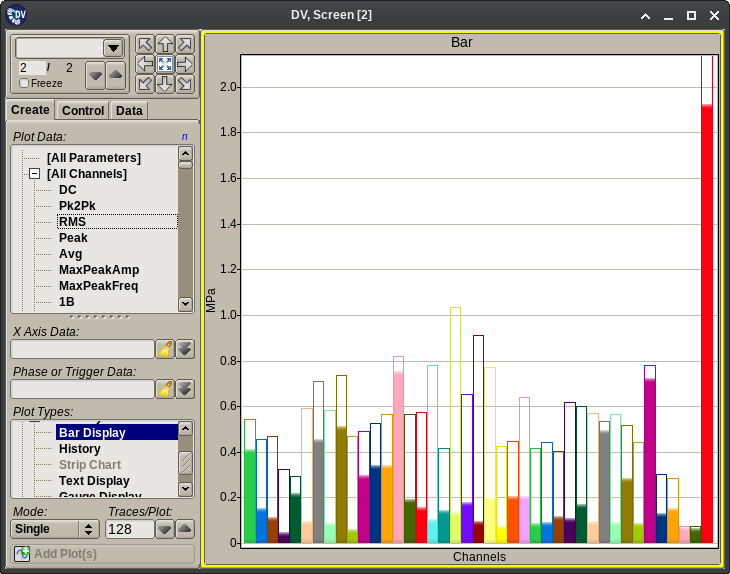

# Bar Plots

Bar Plots show parameter or channel stat current and historical maximum
values displayed as the height of vertcal bars. These plots:

> - Require the selection of the following items on the [plotcreate-link](#plotcreate-link) tab
>   before adding them to the plot grid:
>
>   > - One or more primary parameters or channel stats.
> - Do **not** extend the [plotmenu-link](#plotmenu-link) with additional choices.
> - Do **not** add extra pages to the [plotsetup-link](#plotsetup-link) dialog.
> - Provide **no** additional user interaction mechanisms beyond the 'standard' ones
>   described in the [plotactions-link](#plotactions-link) section.

*Example Bar Plot*
