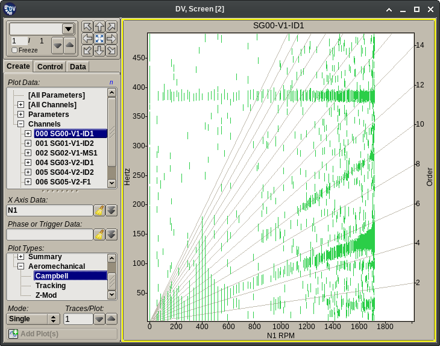
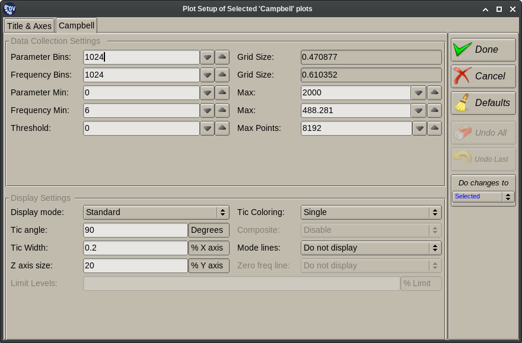

# Campbell Plots

Campbell Plots display collected spectral peak responses from one or more
channels over a two dimensional grid. These plots:

> - Require the selection of the following items on the [plotcreate-link](#plotcreate-link) tab
>   before adding them to the plot grid:
>
>   > - One or more primary data channels. Some display modes are only supported for a single channel plots.
>   > - One optional X axis reference parameter or channel stat.
>   > - One phase reference channel or speed parameter.
> - Extend the [plotmenu-link](#plotmenu-link) with an additional sub-menu. This menu contains shortcuts to settings
>   also available on the Campbell specific Plot Setup dialog page. See descriptions there.
> - Add an extra page to the [plotsetup-link](#plotsetup-link) dialog with Campbell plot specific settings.
> - Provide additional per axis user interaction mechanisms beyond the 'standard' ones
>   described in the [plotactions-link](#plotactions-link) section.

*Example Campbell Plot and Menu*

Campbell plots display spectral peak responses collected over a two dimensional
data grid. The X axis coordinate of the collected data can be time or a user
selected parameter. If the X axis data  is time  then the plot will scroll right
to left the same way as the  [historyplots-link](#historyplots-link).  The left Y axis always
shows frequency units. If the assigned X axis variable is a speed parameter then
the  plot will have a second Y axis on the right that displays orders. If an
order axis is shown its range settings will be locked to those of the X and left
Y axes and will not be independently settable.

The collection grid has a limited number of 'bins' in both directions. Each grid
cell will always contain only one  response (if any), the maximum one seen so
far. In addition the plot also limits the maximum number of non-empty grid
cells, Both of these measures serve the goal of  allowing extended monitoring
sessions without the danger of running out of memory due to  Campbell plots
"growing" without limit.

Campbell plots do store and display the phase of collected responses. However,
these values are largely meaningless unless a phase reference is specified when
the plot is created. The phase reference can be an other channel or a speed
parameter.

All displayed plot axes  support a "collapse plot" action that allows the user
to select a parameter, frequency or (optionally) order  line by dragging the
mouse cursor along the axis. Upon releasing the mouse button the plot will
"collapse" into a regular Cartesian XY plot  along the selected "slice". Using
the right-click menu "Revert" action will restore the original view.

Campbell plots can use the limits associated with the assigned data
channel. For limits to be  visible a properly configured limit file must be
loaded into the application. Also, limits are  only shown on plots that
display a single channel.

Campbell plots support a variety of display modes. Most of these use data "tic
marks" drawn over the data  collection grid. The height, color and orientation
of these tic marks is used to encode information about each response. The
exception is the  "ZMOD" display mode which uses a continuous "rainbow" color
map to represent response magnitudes.

*Example Campbell Plot Setup Page*

The Campbell specific Plot Setup dialog page is divided into two halves. The top
half  controls the data collections options. Changing any of these values will
reconfigure how the plot  collects data, and will also clear any data collected
so far.

- **Parameter Min/Max/Bins/Grid:** Configure the X axis collection grid.
- **Frequency Min/Max/Bins/Grid:** Configure the Y axis collection grid.
- **Threshold:** The minimum peak amplitude the plot will collect.
- **Max Points:** The maximum number of non-empty grid cells.

The bottom half of the panel configures plot display options. Changing these
does not clear the plot.

- **Display Mode:** Controls how the plot is drawn.
  - **Standard:** Two sided tic marks with a horizontal line at the center. The center point corresponds the parameter and frequency location of the response.
  - **Lines:** Same as above except no horizontal line at the center.
  - **One Sided Tics:** Entire tic mark is drawn above the response coordinates.
  - **Circles:** Markers are circles drawn centered at the response coordinates. Diameter represents magnitude.
  - **Squares:** Markers are square boxes drawn centered at the response coordinates. Length of sides represents magnitude.
  - **Phase:** Markers are uniform length, their direction represents the phase of the response.
  - **Z-Mod:** No markers are drawn. Instead a continuous color image is shown with a color key painted in the top left corner of the plot. This mode is **not** available for multi channel plots.
- **Tic Coloring:** Controls the use of colors when drawing the plot (except for the ZMOD display mode).
  - **Single:** All markers are drawn with the same color. This is the **only** mode supported for multi channel plots.
  - **Noise:** Colors are used to indicate which responses are marked noisy during data processing.
  - **Phase:** Colors are used to encode the phase of the displayed responses. A color key "wheel" is also displayed on the plot.
  - **% Limit:** Colors are used to represent whether responses are within limits or not. This requires a loaded limit file.
- **Tic Angle:** The angle at which line mode tics are drawn. 90 degrees (vertical) is the default.
- **Tic Width:** The width of the horizontal marker placed on line tics as a percentage of the X axis size.
- **Z Axis Size:** The length of the plot's Z axis (used to scale responses) as a percentage of the Y axis size.
- **Composite:** Unused. For future expansion.
- **Mode Lines:** Enable or disable the drawing of mode lines when limits are available. This is done on single channel plots only.
- **Zero Freq Line:** Enable or disable drawing of collected time domain statistics values. If drawn these are shown with a zero frequency.
- **Limit Levels:** Used only in the "%limit" color mode. Sets the limit levels where different colors are used.
