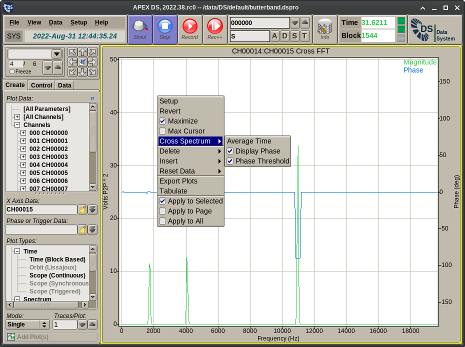
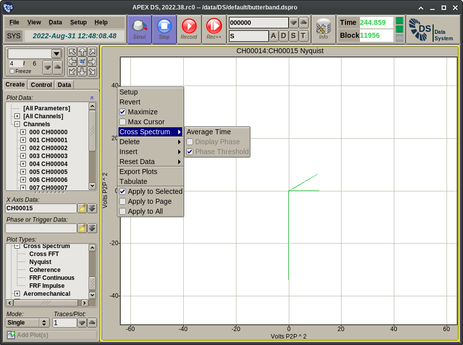
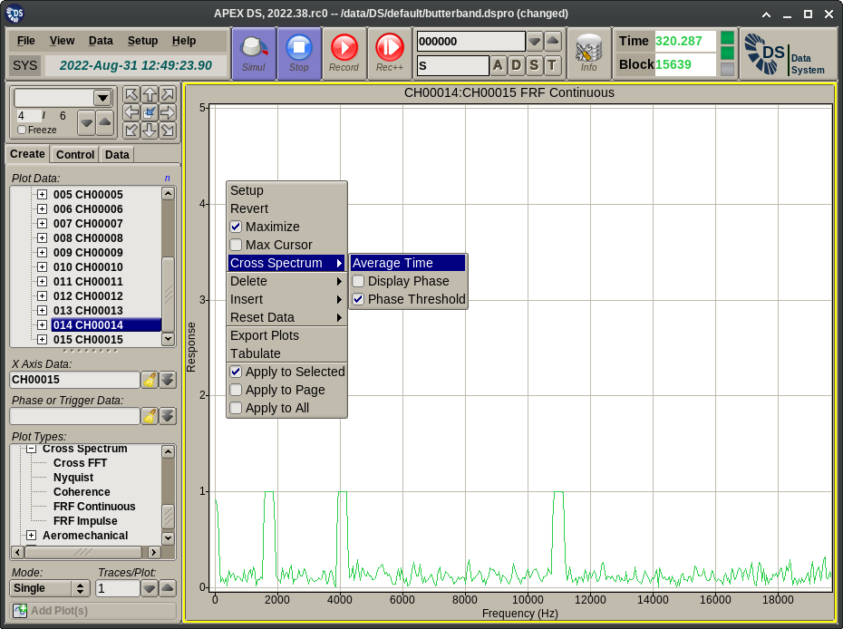
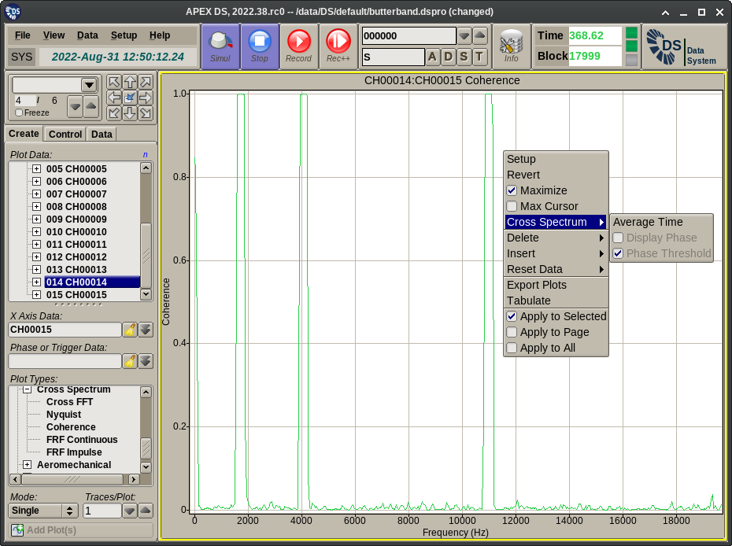

# Cross Spectrum Plots

Cross Spectrum Plots display the complex cross spectrum computed from the FFTs
of the primary channel(s) and  the reference channel. The computed cross
spectrum can be displayed in various forms with or without averaging. These
plots:

> - Require the selection of the following items on the [plotcreate-link](#plotcreate-link) tab
>   before adding them to the plot grid:
>
>   > - One or more primary data channels.
>   > - One reference data channel.
> - Extend the [plotmenu-link](#plotmenu-link) with an additional sub-menu described below.
> - Do **not** add extra pages to the [plotsetup-link](#plotsetup-link) dialog.
> - Provide **no** additional user interaction mechanisms beyond the 'standard' ones
>   described in the [plotactions-link](#plotactions-link) section.

*Example Cross Spectrum Plot and Menu*

*Example Nyquist Plot and Menu*

*Example Frequency Response Function Plot and Menu*

*Example Coherence Plot and Menu*

Cross Spectrum plots have three sub-types depending of the data curve being displayed:

- **Cross FFT** displays the magnitude and optionally the phase of the complex cross spectrum
  computed from the FFTs of the primary and reference channels.
- **Nyquist** displays the complex cross spectrum
  computed from the FFTs of the primary and reference channels in a polar coordinate system.
- **Coherence** displays the magnitude of the complex cross spectrum normalized
  against the product of the primary and reference channel FFT magnitudes. This
  plot  will show unity at parts of the spectrum where the inputs are
  deterministic and less than unity where  the input is noise.
- **FRF Continuous** displays the magnitude and optionally the phase of the
  Frequency Response Function of the primary channel(s) versus the reference.
  This data is computed and collected for each block of the input data.
- **FRF Impulse** displays the magnitude and optionally the phase of the Frequency
  Response Function of the primary channel(s) versus the reference. This data is
  computed and collected only from those blocks of the input data that meet
  certain criteria. This mode of FRF data  collection is mostly useful for
  impact testing. On these plots the FRF is collected and updated only from those
  data blocks that contain a  complete, not truncated impact testing event.

The Plot Menu extension displayed for spectrum plots provides the following functionality:

- **Average:** Displays a dialog for the entry of the time interval over which
  the cross spectrum data  should be averaged. Averaging is exponential.
  Entering 0 disables averaging.
- **Display Phase:** This toggles the display of the phase plot trace. This
  applies to Cross FFT and FRF plots only.
- **Phase Threshold:** This toggles the application of per channel FFT amplitude
  thresholds for the display of the phase curve (when applicable to the selected
  plot type). Typically in regions of the spectrum where the input is only noise
  the phase will be noise too. This option disables the display of this phase
  noise for frequency values where the magnitude of either of the inputs is
  below a threshold. The thresholds used here are the same as the peak extraction
  ones configured on the APEX DS Setup Editor page.

> [!TIP]
> For correct operation of the "FRF Impulse" plots, the acquisition has to be
> configured  in a specific way. The sample rate and block size should be
> configured such that the  time interval covered by each block is longer than
> the time it takes for each impact event to complete. I.e. the exponentially
> decaying responses should (almost) completely disappear within the time frame
> of a single acquisition block. Additionally, for such applications the
> "rectangular" FFT window should be used (i.e. no window).
