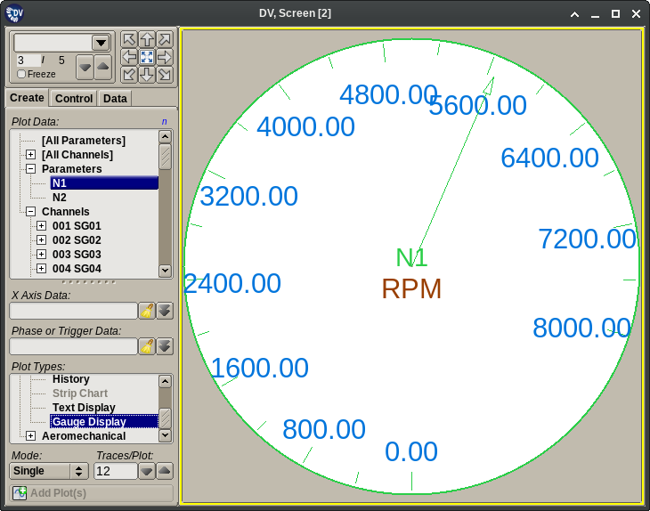

# Gauge Plots

Gauge Plots show the current value of a parameter or channel stat on a
round dial indicator display. These plots:

> - Require the selection of the following items on the [plotcreate-link](#plotcreate-link) tab
>   before adding them to the plot grid:
>
>   > - One primary parameter or channel stat.
> - Do **not** extend the [plotmenu-link](#plotmenu-link) with additional choices.
> - Do **not** add extra pages to the [plotsetup-link](#plotsetup-link) dialog.
> - Provide **no** additional user interaction mechanisms beyond the 'standard' ones
>   described in the [plotactions-link](#plotactions-link) section. However, they do disable the
>   plot data zoom interaction.

*Example Gauge Plot*
