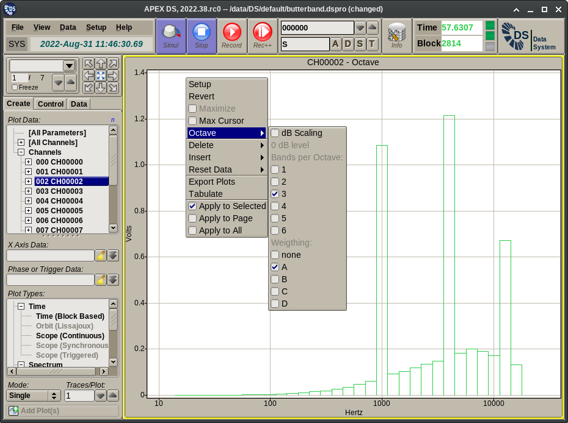

# Octave Plots

Octave Plots display the RMS amplitudes of the outputs from a bank of band pass
filters. The center frequencies and transfer characteristics of the band filters
are selected according to the requirements of the IEC 61260 standard. The bottom
band will always be the standard 15.625Hz center frequency one (1000Hz/64), the
available top frequency band will be determined based on the sample rate of the
channel. These plots:

> - Require the selection of the following items on the [plotcreate-link](#plotcreate-link) tab
>   before adding them to the plot grid:
>
>   > - One or more primary data channels.
> - Extend the [plotmenu-link](#plotmenu-link) with an additional sub-menu described below.
> - Do **not** add extra pages to the [plotsetup-link](#plotsetup-link) dialog.
> - Provide **no** additional user interaction mechanisms beyond the 'standard' ones
>   described in the [plotactions-link](#plotactions-link) section.

*Example Octave Plot and Menu*

The Plot Menu extension displayed for octave plots provides the following
functionality:

- **dB scaling:** Toggles the Y axis scaling between signal RMS amplitude and
  decibel modes.
- **0 dB level:** Available in dB scaled mode only. Sets the data level that
  corresponds to 0 dB.
- **Bands per Octave:** The [1 .. 6] menu choices below this entry allow
  configuring the number of frequency bands (i.e. band filters) created for each
  octave of the frequency range.
- **Weighting:** The [none, A .. D] menu choices below this entry allow
  configuring the weighting curve being applied to the calculated RMS outputs of
  each band filter. Options are no weighting or the use of one of the standard
  IEC A, B, C, or D curves.

> [!NOTE]
> The RMS output calculation for each band pass filter is done using an
> exponential averaging method. The time constant of the averaging is different
> for each band, and is determined such that a constant number of periods (at the band
> center frequency) are being averaged. This means that the settling time of the
> RMS output amplitudes will be different for each band, and tend to be slower at
> the low end of the spectrum.
