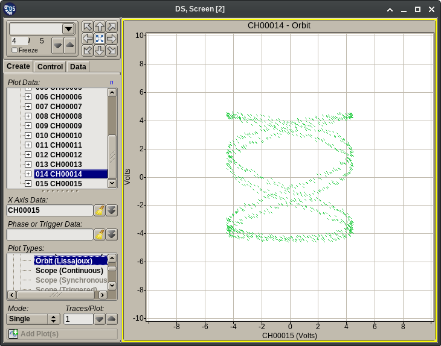

# Orbit Plots

Orbit Plots (also known as Lissajoux plots) display the current data block's
samples from one or more channels on the Y axis against samples of one channel
on the X axis. These plots:

> - Require the selection of the following items on the [plotcreate-link](#plotcreate-link) tab
>   before adding them to the plot grid:
>
>   > - One or more primary data channels.
>   > - One data channel for the X axis.
> - Do **not** extend the [plotmenu-link](#plotmenu-link) with additional choices.
> - Do **not** add extra pages to the [plotsetup-link](#plotsetup-link) dialog.
> - Provide **no** additional user interaction mechanisms beyond the 'standard' ones
>   described in the [plotactions-link](#plotactions-link) section.

*Example Orbit Plot*
