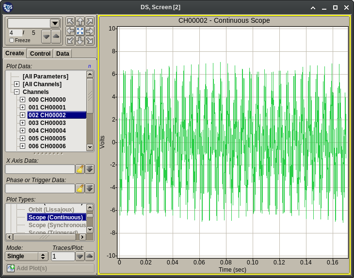

# Scope Plots

Scope Plots display a configurable number of samples from one or more data
blocks collected from one or more channels. These plots:

> - Require the selection of the following items on the [plotcreate-link](#plotcreate-link) tab
>   before adding them to the plot grid:
>
>   > - One or more primary data channels.
>   > - For some sub-types a speed parameter used for triggering.
> - Do **not** extend the [plotmenu-link](#plotmenu-link) with additional choices.
> - Do **not** add extra pages to the [plotsetup-link](#plotsetup-link) dialog.
> - Provide **no** additional user interaction mechanisms beyond the 'standard' ones
>   described in the [plotactions-link](#plotactions-link) section.

*Example Scope Plot*

Scope Plots operate on variable length **sweeps** of data samples. They collect
these sweeps in  **double buffered** mode. This means that while one buffer is
displayed, the other one is collecting samples. Once the collection is done, the
buffers switch roles. The sweep length is adjustable simply by changing the X
axis range of the plot.

Scope Plots have three sub-types. These differ in how they start collecting
a sweep's samples and in the length of the collected sweeps.

- **Continuous Scope** plots start collecting the next sweep immediately after
  the previous one is completed.
- **Triggered Scope** plots require the selection of a trigger (speed) parameter
  when they are created. They will start collecting the next sweep's samples
  upon the detection of the next trigger pulse.
- **Synchronous Scope** plots are similar to the triggered ones above, except
  that they also dynamically adjust the length of their sweeps based on the
  distance between successive trigger pulses. These plots scale their X axes in
  degrees instead of a time unit. The default 0 .. 360  degree scaling will
  display samples between two trigger pulses (these typically correspond to
  revolutions of a rotating part).

> [!TIP]
> Due to the role the plot's X axis range plays in determining the sweep length
> using any of the 'auto' axis range modes is discouraged.
