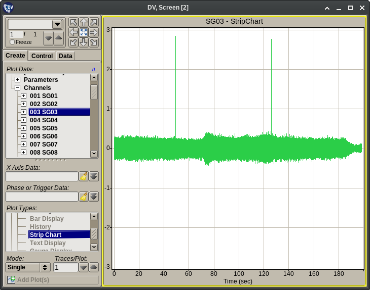

# Strip Chart Plots

Strip Chart Plots display a longer term outline of the waverform(s) from one or
more channels. These plots:

> - Require the selection of the following items on the [plotcreate-link](#plotcreate-link) tab
>   before adding them to the plot grid:
>
>   > - One or more primary data channels.
> - Do **not** extend the [plotmenu-link](#plotmenu-link) with additional choices.
> - Do **not** add extra pages to the [plotsetup-link](#plotsetup-link) dialog.
> - Provide **no** additional user interaction mechanisms beyond the 'standard' ones
>   described in the [plotactions-link](#plotactions-link) section.

*Example Strip Chart Plot*

> [!TIP]
> Due to the way these plots are drawn, configuring more than one trace per
> plot is probably not very useful.
