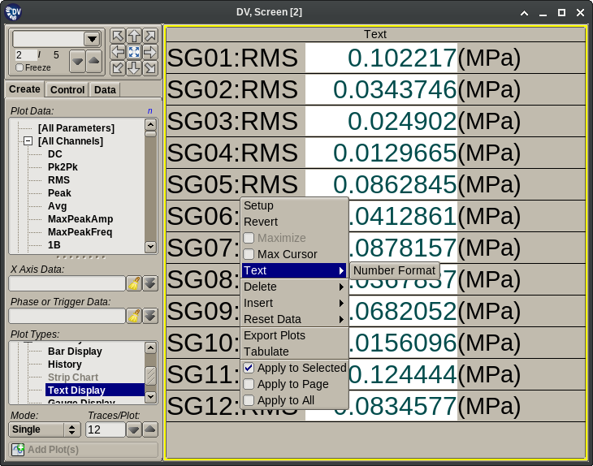

# Text Plots

Text Plots display the current value of selected parameters or channel stats
in a plot grid cell formatted as text. These plots:

> - Require the selection of the following items on the [plotcreate-link](#plotcreate-link) tab
>   before adding them to the plot grid:
>
>   > - One or more primary parameters or channel stats.
> - Extend the [plotmenu-link](#plotmenu-link) with an additional choice that will prompt
>   the user for a C-style format string to use for printing the displayd
>   numeric values.
> - Do **not** add extra pages to the [plotsetup-link](#plotsetup-link) dialog.
> - Provide **no** additional user interaction mechanisms beyond the 'standard' ones
>   described in the [plotactions-link](#plotactions-link) section. However, they do disable the
>   plot data zoom interaction.

*Example Text Plot and Menu*

These plots use a text coloring scheme for indicating displayed data item alarm
levels. The meaning of the colors is as follows:

> - **No Color**: (white, gray) means that there are no alarm limits defined for
>   the given stat or parameter.
> - **Green**: means that limits are defined and the displayed value is below the
>   alarm levels.
> - **Yellow**: means that the displayed value has exceeded the warning (i.e. reduced
>   alarm) level.
> - **Red**: means that the displayed value has exceeded the its alarm level. Items
>   that have no limits defined still  can reach this state if they exceed a
>   value computed from their monitoring limits defined during acquisition setup.
