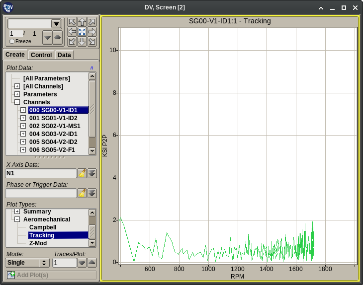
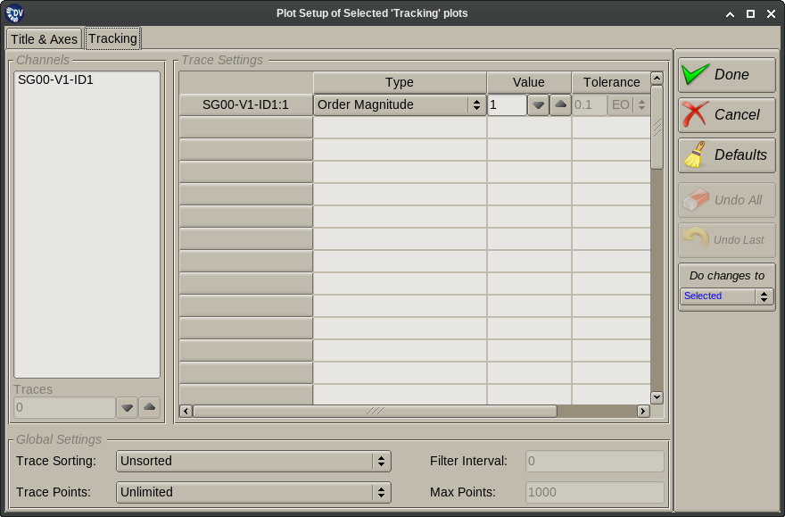

# Tracking Plots

Tracking Plots display the collected spectral peak responses in one or more
frequency bands from one or more channels. These plots:

> - Require the selection of the following items on the [plotcreate-link](#plotcreate-link) tab
>   before adding them to the plot grid:
>
>   > - One or more primary data channels.
>   > - One optional X axis reference parameter or channel stat.
>   > - One phase reference channel or speed parameter.
> - Do **not** extend the [plotmenu-link](#plotmenu-link) with additional choices.
> - Add an extra page to the [plotsetup-link](#plotsetup-link) dialog with tracking plot specific settings.
> - Provide **no** additional user interaction mechanisms beyond the 'standard' ones
>   described in the [plotactions-link](#plotactions-link) section.

*Example Tracking Plot*

Tracking plots collect and display spectral peak responses collected in user defined
frequency bands. Three collection methods are supported:

- **DFT Order Tracking:** This method requires that a speed parameter is used as
  the plot's X axis. The plot will collect time domain data  samples between two
  trigger pulses of the speed parameter. The collected data samples will then be
  analyzed using variable length DFT (Discrete  Fourier Transform) processing to
  extract the response at the desired order. Response magnitudes and phases can
  be collected this way.
- **FFT Order Tracking:** This method also requires that a speed parameter is
  used as the plot's X axis. The plot will collect the largest FFT responses
  from each processed data block that match  the specified order and tolerance
  interval. Response magnitudes and phases can be collected this way.
- **FFT Band Tracking:** This method collects peak responses that match a user
  defined fixed nominal frequency and tolerance range. Response magnitudes and
  actual frequencies can be collected this way.

Collected response curves can be further refined using various sorting and
filtering options.

*Example Tracking Plot Setup Page*

Tracking plots have their own specific Plot Setup dialog page, The top part of
this panel allows  the definition of the collected tracking curves. For each
channel a user defined number of tracking curves can be added. The collection
method, nominal value, tolerance band and threshold of each curve is
individually adjustable.

The bottom half of the panel controls global options that apply to each
collected tracking curve.

- **Trace Sorting:** Controls whether the plot collects tracking curve points in
  the  order of arrival or sorted. In the second case the points can be filtered
  to produce a "smoother" tracking curve.
- **Trace Points:** Optionally limit the maximum number of points for each
  tracking curve. This is done  by finding the two points with the nearest X
  values and replacing them with a single point whose X and T values are the
  averages of the replaced ones.
- **Filter Interval:** This is used for sorted and filtered tracking curves.
  Each newly added curve point's Y value is replaced with the average of itself
  and all already existing points  that fall within the specified parameter
  distance range.
- **Max Points:** This is the maximum point used when trace size limiting is
  enabled.
