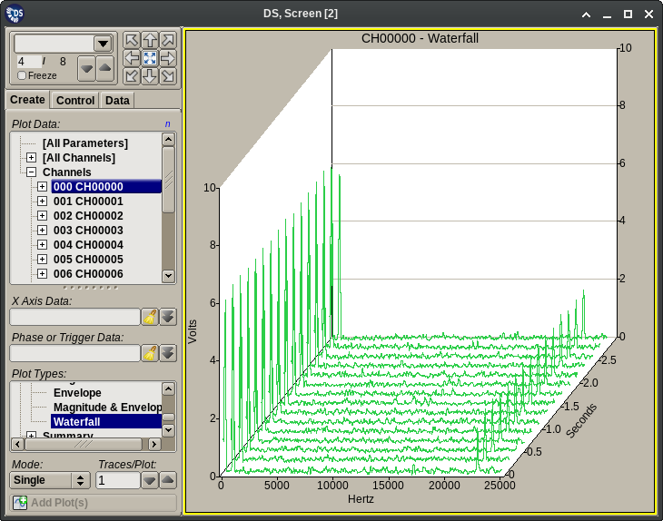
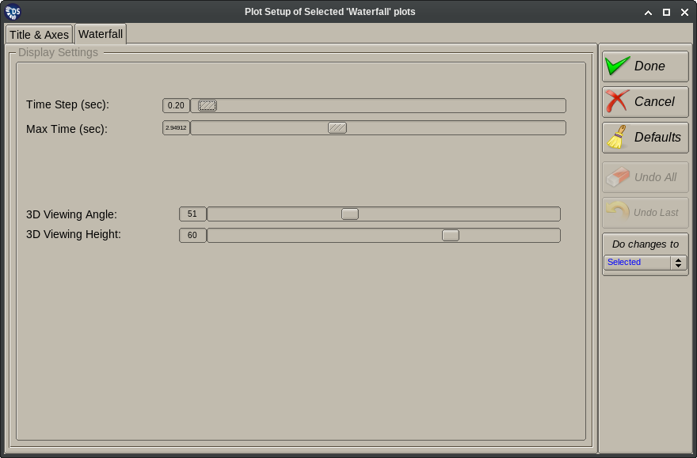

# Waterfall Plots

Waterfall Plots display multiple spectrum data curves from one channel only.
These plots:

> - Require the selection of the following items on the [plotcreate-link](#plotcreate-link) tab
>   before adding them to the plot grid:
>   - One primary data channel.
>   - One optional parameter or channel stat selection on the X axis input.
> - Do **not** extend the [plotmenu-link](#plotmenu-link) with additional choices.
> - Add an extra page to the [plotsetup-link](#plotsetup-link) dialog as shown below.
> - Provide **no** additional user interaction mechanisms beyond the 'standard' ones
>   described in the [plotactions-link](#plotactions-link) section.

*Example Waterfall Plot*

Waterfall plots are rendered as a 3D projection of multiple spectrum data
curves. The X (horizontal) axis is frequency, the Y (diagonal) axis is a user
selectable parameter and the Z (vertical) axis is spectrum magnitude. Each
displayed curve is the maximum of several per block spectrum traces, collected
according to the spacing of the waterfall lines.

Depending on the Y (parameter) axis variable waterfall plots can be rendered in
one  of two possible ways:

- **Time Waterfall** plots display time delays on their Y (diagonal) axis. The
  most recent  spectrum curve is always at the front and older spectrum lines
  will "scroll out" of the  plot as time advances.
- **Parameter Waterfall** plots map the range of the selected parameter or
  channel stat on the Y axis. In this case the Y axis is stationary, it will not
  scroll.

  > [!NOTE]
  > The Y axis Waterfall Plot parameter or stat has to be selected on the X
  > axis input field of the plot creation tab.

Waterfall plots add a second page to the Plot Setup dialog as shown on the image
below.  The purpose of this page is to adjust the spectrum line count and
spacing of the plot. It is also possible to change the 3D projection angles on
this page.

*Example Waterfall Plot Setup Page*
