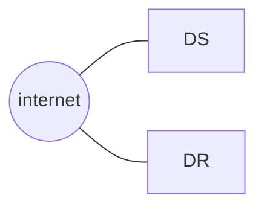
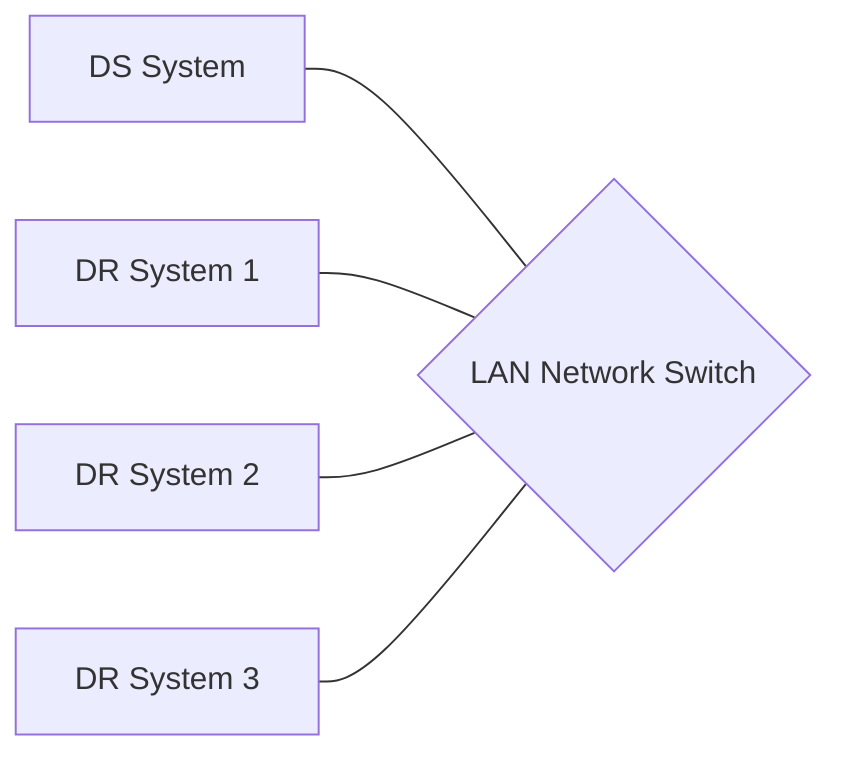
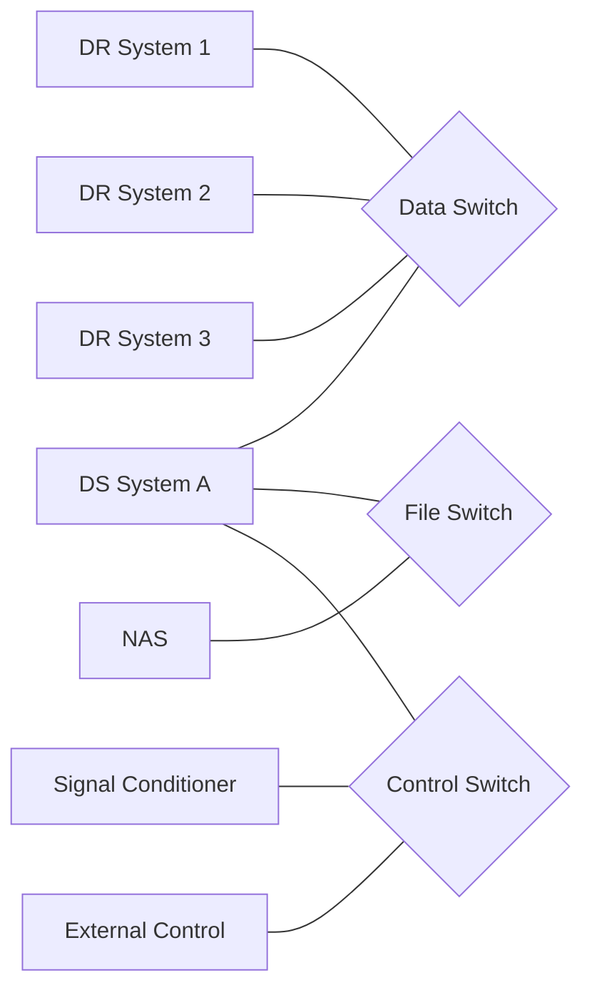
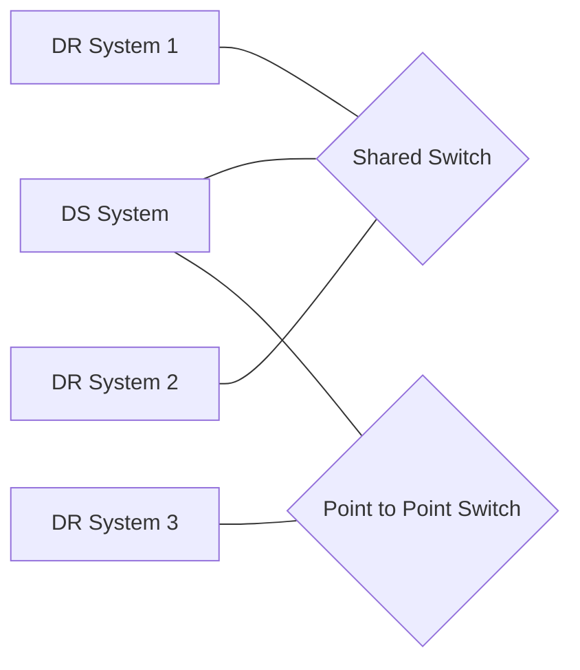

# Networking

## TCP/UDP Ports

| Port | Protocol | Use |
| --- | --- | --- |
| 10995 | TCP | API/DR data and control |
| 10996 | TCP | API/DR data and control |
| 10997 | TCP | API/DR data and control |
| 10998 | TCP | API/DR data and control |
| 10999 | TCP | API/DR data and control |
| 11000 | TCP | API/DR data and control |
| 11001 | TCP | API/DR data and control |
| 11002 | TCP | API/DR data and control |
| 11003 | TCP | API/DR data and control |
| 11004 | TCP | API/DR data and control |
| 10995 | UDP | API/DR broadcast info |

## Overview

DS provides a robust TCP based networking to distribute data to either DR clients or to user developed clients that make use of the DS networking API.
The networking protocol is design to dynamically adapt the transmitted data rate (per client) based on a composite of network bandwidth, client processing power and client application performance.
The effect of this is that a client can expect to receive data at a rate the will accommodate the performance of the **entire data flow path**.
The typical limiter of the data rate is the network bandwidth; given sufficient bandwidth and processing performance by the client it is possible to receive all data from DS.
This would allow users to write custom programs, using the DS API, and have the ability to capture, process and record all time domain data.
The DR application uses this same protocol to receive data from DS. The plot update rate of a DR client is dependent on the available network bandwidth, the performance of the system and the performance of the DR application specifically, plots.

## Robustness

Previous version of EDAS-ds ( <= 2.94 ) used multicast based networking to distribute data. The DS 3 series completely ditched multicast and has a brand new TCP based implementation to distribute data.
The primary failing of the multicast network was it lack of robustness w.r.t network design; it required specific network design, lacking this the likely outcome was EDAS-dr clients losing their connections to EDAS-ds.
The new DS 3 series networking *does not require a optimal network design*. If the network is poorly designed and it is heavily and/or erratically loaded, the DR clients will get data updates only at a reduced rate that is limited by the available network bandwidth.
It is however *highly recommended* that users do a bandwidth analysis of their network so as to ensure adequate update performance to all DR clients.

## Detection

## Subscription

A key feature to managing bandwidth usage with the TCP connection is the use of subscription to channels. In EDAS-ds ( <= 2.94 ) all channels were sent on the multicast regardless if any client was actually viewing the data.
The DS 3 series networking allows individual clients to *"subscribe*" to channels. Subscribing to a channel in DR simply means make the channel available for plotting. DR also has the intelligence to dynamically tune the subscription to channels based on if the plot is visible, this excludes any plots that require history - only for instantaneous data (i.e. Time or Magnitude Plots).
The DS API can read any and all data types continuously or at the users discretion.

> [!WARNING]
> User programs making use of the API can very easily consume all remaining network bandwidth.

## Plot Update Rates

| DS Configuration |  |  |
| --- | --- | --- |
| DS channel count | 64 |  |
| DS sample rate | 200kHz |  |
| DS block size | 4096 |  |
| Max possible block rate | 48.8 blocks/sec | sr/blocksize |
| Worst case DR visible plots (1 display) | 64 Time, 64 Mag Env |  |
| Approximate maximum (1) DR bandwidth | 51 MB/sec | block rate*blocksize*channels*bytesperchannel*packettypes |

> [!NOTE]
> Plot update rate is always limited by sample rate / block size.

*DR performance expectations for a minimal network design with the given DS Configuration:*

|  |  |  |
| --- | --- | --- |
| DR connections | Approximate expected update rate | 1GB switch utilization |
| 1 | 48 plots / second | ~40% |
| 2 | 48 plots / second | ~81% |
| 3 | 16 plots / second | 100% |
| 4 | 12 plots / second | 100% |
| 5 | 9 plots / second | 100% |
| 6 | 8 plots / second | 100% |
| 7 | 7 plots / second | 100% |
| 8 | 6 plots / second | 100% |

## Network Designs

The following network diagrams indicate the physical network wiring. Each named rectangle indicates a computer system and each line exiting a system indicates a separate physical NIC.
The named bars indicate a separate isolated physical network switch. The network addressing is **not** shown on these diagrams.

> [!NOTE]
> All network designs assume access to 1GB networking gear unless otherwise noted. Variations from this will change the design targets.

### Uncontrolled Network

An uncontrolled network is the simple case of users has no ability to change the network design. This would be the case in connection over a corporate intranet or in general over the Internet.
In this case the bandwidth could be minimal and/or erratic. DS clients will have no issue receiving data in the scenario.
DS clients require TCP connectivity to ports 10995 -> 11005. DS uses one port per instance running on a machine, alternate ports in the range given are used in the case of another DS using another.
Lacking ability change a network will work with DS 3 networking and will provide updates to the client as the networking bandwidth allows.

> [!WARNING]
> DS data is not encrypted, users must make use of appropriate VPN or ssh tunneling as required.

### Minimal Network Design

The minimal network design target will make use of a flat network layout on an isolated LAN using a 1GB network switch. Each DS and DR system is configured with a single 1GB NIC.
The assumption is that the isolated LAN will have some other networking traffic but will be related to DS operation and/or controlled file transfers of DS generated files.

### Duty Segregated Network

This network design full isolates the data, file transfers and control into separate physical networks.
Isolation of these separate functions prevents network bandwidth limitations between them.
The disadvantage of this design is it requires multiple network switches and NICs.

### High Bandwidth Client

The high bandwidth client alteration allows a single client to potentially have full network bandwidth to the real time data.
The typical case where this may be needed is if a user has a custom client that makes use of the DS API.
By using the DS API an application may be developed that can receive all of the time series data and perform its own processing.
Isolating these types of clients gives reasonable guarantees that the client will not lose to bandwidth other clients.

