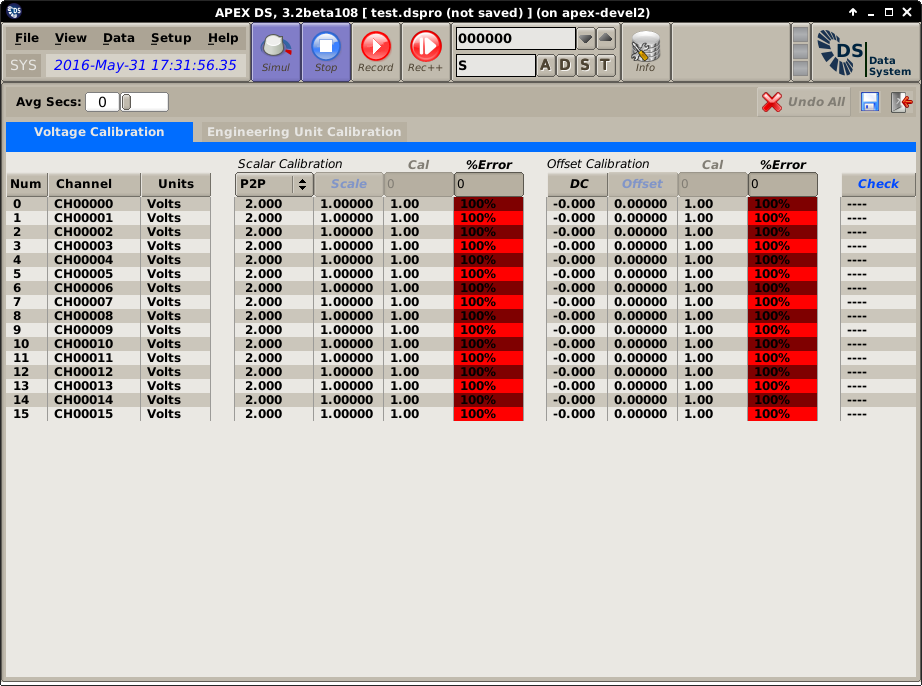
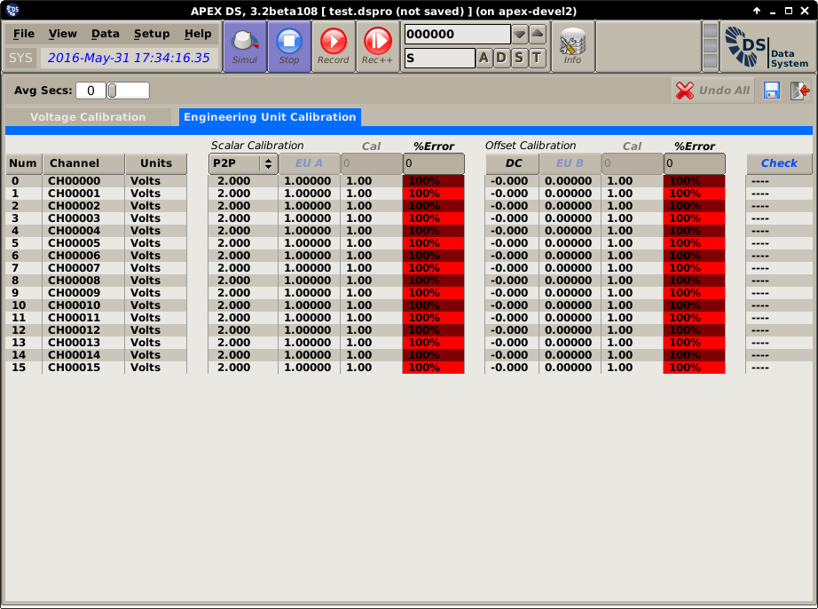

# Calibration View

The calibration panel provides the ability to do a software calibration of voltage and engineering units (EU).

> - Avg Secs: Control that averages the values shown in both voltage and EU calibration panels.
> - Undo All: Undo all changes to the setup since the last time the main setup panel was changed and accepted.
> - Save: Save current calibration table to a csv file.
> - Exit: Exit calibration panel.

General overview of calibration theory can be viewed here [Calibration Theory](#calibration-theory)

## Voltage Calibration

*Example Voltage Calibration Panel*

- **The table header contains Buttons that perform various functions, these buttons are coded in blue text. They are:**: - Scale - Perform auto adjust for selected channels of scale based on input voltage and cal target.
- Offset - Perform auto adjust for selected channels of offset based on input voltage and cal target.
- Check - Determine if the selected channel(s) % errors are less than the channels %error.

> [!NOTE]
> Placing a Cal value of 0.0 in a channel and clicking "Scale" will reset the Scale and Offset values (1.0 and 0.0 respectively).

Column descriptions

<table>
  <tbody>
    <tr>
      <td>Num</td>
      <td>Channel number</td>
    </tr>
    <tr>
      <td>Channel</td>
      <td>Channel name</td>
    </tr>
    <tr>
      <td>Units</td>
      <td>Channel units</td>
    </tr>
    <tr>
      <td></td>
      <td></td>
    </tr>
    <tr>
      <td colspan="2"><strong>Scalar Calibration</strong></td>
    </tr>
    <tr>
      <td>P2P, sa-Pk, RMS, MaxPeakAmp, DC</td>
      <td>Channel voltage statistic value being used to calibrate the scalar.</td>
    </tr>
    <tr>
      <td>Scale</td>
      <td>Current scalar applied</td>
    </tr>
    <tr>
      <td>Cal</td>
      <td>Target calibration voltage for the scalar.</td>
    </tr>
    <tr>
      <td>%Error</td>
      <td>Percent error between current voltage value and target calibration</td>
    </tr>
    <tr>
      <td></td>
      <td></td>
    </tr>
    <tr>
      <td colspan="2"><strong>Offset Calibration</strong></td>
    </tr>
    <tr>
      <td>DC</td>
      <td>Channel DC voltage value.</td>
    </tr>
    <tr>
      <td>Offset</td>
      <td>Current offset applied.</td>
    </tr>
    <tr>
      <td>Cal</td>
      <td>Target calibration voltage for the offset.</td>
    </tr>
    <tr>
      <td>%Error</td>
      <td>Percent error between current DC voltage and target offset.</td>
    </tr>
    <tr>
      <td></td>
      <td></td>
    </tr>
    <tr>
      <td>Check</td>
      <td>Indicate with PASS/FALL depending on if the channels scalar and offset error are less/more than the channels %error tolerance.</td>
    </tr>
  </tbody>
</table>

## EU Calibration

*Example Eu Calibration Panel*

- **The table header contains Buttons that perform various functions, these buttons are coded in blue text. They are:**: - EU A - Perform auto adjust for selected channels of EU A scale based on input Eu's and cal target.
- EU B - Perform auto adjust for selected channels of EU B offset based on input Eu's and cal target.
- Check - Determine if the selected channel(s) % errors are less than the channels %error.

> [!NOTE]
> Placing a Cal value of 0.0 in a channel and clicking "EU A" will reset the Scale and Offset values (1.0 and 0.0 respectively).

Column descriptions

<table>
  <tbody>
    <tr>
      <td>Num</td>
      <td>Channel number</td>
    </tr>
    <tr>
      <td>Channel</td>
      <td>Channel name</td>
    </tr>
    <tr>
      <td>Units</td>
      <td>Channel units</td>
    </tr>
    <tr>
      <td></td>
      <td></td>
    </tr>
    <tr>
      <td colspan="2"><strong>Scalar Calibration</strong></td>
    </tr>
    <tr>
      <td>P2P, sa-Pk, RMS, MaxPeakAmp, DC</td>
      <td>Channel voltage statistic value being used to calibrate the scalar.</td>
    </tr>
    <tr>
      <td>EU A</td>
      <td>Current EU A scalar applied</td>
    </tr>
    <tr>
      <td>Cal</td>
      <td>Target calibration voltage for the scalar.</td>
    </tr>
    <tr>
      <td>%Error</td>
      <td>Percent error between current voltage value and target calibration</td>
    </tr>
    <tr>
      <td></td>
      <td></td>
    </tr>
    <tr>
      <td colspan="2"><strong>Offset Calibration</strong></td>
    </tr>
    <tr>
      <td>DC</td>
      <td>Channel DC voltage value.</td>
    </tr>
    <tr>
      <td>EU B</td>
      <td>Current EU B offset applied.</td>
    </tr>
    <tr>
      <td>Cal</td>
      <td>Target calibration voltage for the offset.</td>
    </tr>
    <tr>
      <td>%Error</td>
      <td>Percent error between current DC voltage and target offset.</td>
    </tr>
    <tr>
      <td></td>
      <td></td>
    </tr>
    <tr>
      <td>Check</td>
      <td>Indicate with PASS/FALL depending on if the channels scalar and offset error are less/more than the channels %error tolerance.</td>
    </tr>
  </tbody>
</table>

## Calibration Theory

The interface described above can be used to perform two different
calibration tasks:

1. Validate the operation of the DS ADC device.
2. Perform an end to end calibration of the DS ADC device together with
  as much of the signal path (conditioner, sensor, etc.) as possible.

The procedures are essentially the same for both tasks, they involve
applying a calibrated, traceable signal level to inputs of the system at
the appropriate stage (high level voltage at ADC inputs, low-level
voltage or current at signal conditioner inputs or actual physical
quantities at sensors) and developing a set of DS EU factors that will
produce correct readings for the corresponding input levels. The
difference is only how these EU values are used: in an end to end
calibration for test they are the end result, while when used for
assessing the quality of the DS ADC inputs, their deviation from some
"ideal" values (normally 1 for gain and 0 for offset) is what matters.

The generation of transfer standard inputs for physical quantities (i.e.
sensor inputs) is beyond the scope of this manual. To generate transfer
standard electrical signal levels (for DS ADC inputs or for signal
conditioner inputs), the typical procedure is to use a waveform
generator and a calibrated digital multimeter to measure its output.
This way the signal source does not have do be calibrated, the only
requirement is that its output is stable. The digital multimeter should
have its accuracy checked by a calibration lab, and should have about an
order of magnitude better accuracy than the DS ADC device. For a typical
16 bit ADC converter (about 5 1/2 digits), a 6 1/2 digit multimeter
(Agilent 34401A or similar) is appropriate.

The following sections describe calibration procedures:

1. [AC Calibration](#ac_calibration)
2. [DC Calibration](#dc_calibration)
3. [ADC Accuracy Assessment](#adc_accuracy_assessment)
4. [ADC Frequency Response
  Assessment](#adc_frequency_response_assessment)
5. [ADC Clock Accuracy Assessment](#adc_clock_accuracy_assessment)
6. [ADC Intra Channel Phase
  Assessment](#adc_intra_channel_phase_assessment)

### AC Calibration

When channels of the system operate in AC coupled mode, only the gain
(EU A) has to be calibrated. This can be accomplished by applying a
calibrated sine wave signal to the inputs, and adjusting the EU A
factors (using either the "forward" or "backward" method) such that the
correct output level is displayed. For the lowest error due to any
potential noise the RMS value of the signal should be measured and used
as the target value for the calibration.

### DC Calibration

Calibrating DC coupled channels means adjusting both the gain and the
offset. There are two possible methods for accomplishing this:

1. Apply a sine wave signal with a calibrated DC offset and RMS value to
  the inputs. First adjust the gain based on the RMS value, then adjust
  the offset using the signal's DC component.
2. Perform the two point DC calibration process described in the
  previous section.

### ADC Accuracy Assessment

When the above AC or DC calibration procedures are used to assess the
accuracy of an ADC device, start with an DS setup with all channels set
to the "EU/Volts" mode, EU A factor equal to 1, and EU B (if applicable,
not used for AC channels) set to 0. Then perform the appropriate (AC or
DC) calibration procedure from above. The deviation of the resulting EU
factors from their ideal values (1 for gain, 0 for offset) is the
indicator of the ADC errors.

To assess the linearity of the ADC over its full range perform the
procedure several times in smaller regions of the entire input range.
Three measurements are suggested:

1. Near full range: For example, if the ADC operates in a +-2.5 Volts
  range, perform a calibration using an input signal ranging between -2
  and +2 Volts.
2. Positive values only: For example, if the ADC operates in a +-2.5
  Volts range, perform a calibration using an input signal ranging
  between +0.5 and +2 Volts.
3. Negative values only: For example, if the ADC operates in a +-2.5
  Volts range, perform a calibration using an input signal ranging
  between -0.5 and -2 Volts.

The deviations between the three sets of values are indicative of the
ADC's non-linearity.

### ADC Frequency Response Assessment

By performing AC calibrations at different frequencies, it is possible
to map out the ADC's frequency response. First, create a test setup with
a sampling rate near the maximum supported by the given ADC and DS
configuration, Then perform AC calibrations at different frequencies, at
a minimum at the following three values:

1. 45% of the sampling rate (i.e. near the bandwidth, or Nyquist
  frequency)
2. 25% of the sampling rate (i.e. at half bandwidth)
3. 5% of the sampling rate (for low frequency evaluation)

### ADC Clock Accuracy Assessment

Generally, ADC converters use accurate and stable (to the order of
10 -7 ... 10 -8) crystal oscillators as the base from
which they derive the sampling clock. This feature of the boards
typically does not need to be validated. However, if it is desired to
validate ADC clocks, the procedure described below can be used.

DS displays a running acquisition time on its status bar at the top of
its Main Window. This timer is initialized to the system clock's value
at acquisition start, but then incremented based on the acquired sample
count and sampling rate. Therefore any drift in the displayed time value
from real time is indicative of ADC clock errors. Note that this time
code is displayed only if there is no IRIG channel set up on the system,
in which case time display switches over to the decoded IRIG value.

### ADC Intra Channel Phase Assessment

The best way to assess the phase relationship between channels in DS is
to use the Orbit Plot. (I.e. close the calibration screen and return to
normal operating mode to perform this test.) Set up a screen with Orbit
plots for all channels, all using a single common channel for reference.
Apply a sine wave input to the system near the Nyquist rate. A display
like below should be visible.

Any deviation from a straight line is a phase error between channels.
Note that 1..2 degree errors at high frequencies (say 100kHz signal at
220kHz sampling rate) are expected, these represent very small time
differences at these frequencies. They can be due to different cable and
signal path lengths (ADC components on different locations of the ADC's
circuit board!), and small variances in ADC on-board filter components.
(Sigma-delta ADC-s typically use RC anti-aliasing pre-filters.)

This test can be especially important in distributed DS systems where
the clock signal has to be routed to several computers housing the ADC
equipment. It can be used then to assess the quality of the ADC clock
cabling between systems.
