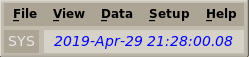
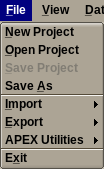
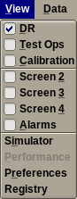
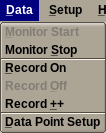
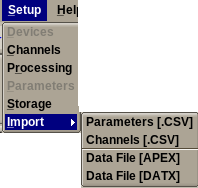
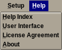

# Menu Toolbar

The Main Menu of the APEX DS user interface can be used to access most functions of
the application. Entries under the different sub-menus will be activated or
deactivated based on the status (idle or running, input source, valid or invalid
configuration, etc..) of the application.

> [!NOTE]
> Any menu option that requires a file browser is always disabled when the
> APEX DS application is in the “running” state. The reason is that
> displaying a file browser would stop all updates on all user interface
> windows.

## Time Display

The time status display has two components.

> - The time source display (left, showing SYS) shows either “IRIG” or “SYS”
>   indicating the source of the time stamp. SYS indicates the time and date is
>   directly from the OS system clock. IRIG means the time is sourced from an
>   input data source. This can be either an analog channel configured to acquire
>   the output of an IRIG-B generator or a digital time stamp provided by an
>   acquisition device.
> - The time value display (on the right) indicates the acquisition time and
>   date that corresponds to the currently displayed data block.

## File Menu

The entries under this sub-menu perform various project and project
file component related operations.

> - **New Project**: Clear out the current project and create a new project with
>   16 channels and a simulated data source. User will be prompted for the new
>   project name. The new project will inherit the current project's storage
>   "data root" settings. All other project items are reset to their default
>   values.
> - **Open Project**: Select a previously saved project file and attempt to load
>   it into the DS application.
> - **Save Project**: Save all project components using the last selected
>   project file name.
> - **Save As**: Save all project components using a newly selected project
>   file name.
> - **Import** sub-menu:
>   - **Plot Setup**: Import plot setup from a .csv file. The plot setup can be
>     from any previous DS (3.x or later) or EDAS-ds (2.x) version.
>   - **Limit Setup**: Import limit setup from a .csv file. The limit setup can
>     be from any previous APEX DS (3.x or later), EDAS-ds (2.x),  APEX DX,
>     WorkFlow or Limit Utility version. The .csv format reader used for this
>     task is fairly flexible, it can recognize and convert almost all
>     "historical" EDAS and APEX limit file formats.
>   - **Remove Limits**: Unloads a previously loaded limit file, thereby removes
>     any limit indicators from data plots and other displays.
>   - **Unit Table**: Import table of integration units from a .csv file.
>   - **DATX Template**: Import DATX template file. The keyword and value pairs
>     from this template will be merged with the internally generated fields
>     when writing the header section of recorded DATX format data files.
> - **Export** sub-menu:
>   - **Plot Setup**: Export current plot layout to a .csv file.
>   - **Limit Setup**: Export limit setup to a .csv file.
>   - **Plot Data**: Export plots to png images, text or pptx. Export panel
>     provides option to export for selected plots, current page or all plots.
>   - **Unit Table**: Export the table of the integration units to a .csv file.
>     This will create an example integration table if a table has not already
>     been loaded.
>   - **Channels**: Export setup channels to a .csv file. The matching “export”
>     functionality is under the "Setup" sub-menu.
>   - **Parameters**: Export setup parameters to a .csv file. The matching
>     “export” functionality is under the "Setup" sub-menu.
> - **APEX Utilities** sub-menu:
>   - **Limits Utility**: Attempts to launch the APEX Limits Utility
>     (limit file editor) if it is installed.
>   - **DV**: Attempts to launch the APEX DV utility if it is installed.
> - **Exit**: Terminates the APEX DS application. Will prompt the user to save
>   any pending changes to the current project. This choice is grayed out while
>   the application is in the "running" state.

## View Menu

The entries under this sub-menu switch the main workspace area of the
application window into different modes, or show and hide various
additional dialog windows.

> - **DR**: Switches the main workspace area of the application window to
>   the default "Data Plots" view. This choice may be
>   grayed out depending on the licensing status of the application.
> - **Test Ops**: Switches the main workspace area of the application window
>   to the alternate test operations view. This view provides a fixed
>   overview of all channels and parameters with the ability to zoom in to
>   show details about a single selection.
> - **Calibration**: Switches the main workspace area of the application
>   window to a view that allows for software calibration of the ADC voltage
>   and EU (engineering unit) scale factors.
> - **Screen 2**, **Screen 3**, **Screen 4**: These menu choices enable or
>   disable additional windows that display separate instances of the Data Plots
>   view. These choices may be grayed out depending on the licensing status of
>   the application.
> - **Alarms**: Displays the alarm monitoring dialog window. This can be used to
>   monitor the current value and alarm levels of parameter and channel
>   statistics data items.
> - **Simulator**: Shows the data simulator window. This choice is grayed out
>   if the APEX DS application is configured for  a non-simulated input mode.
> - **Performance**: Displays a dynamically updated dialog window that shows
>   current data delay levels at various stages of the data processing
>   inside the DS application.
> - **Preferences**: Shows application preferences dialog.
> - **Registry**: View and optionally clear registry settings used by the
>   application.

## Data Menu

This sub-menu contains entries for controlling the data monitoring and recording
functions of the APEX DS application. Entries may be enabled or grayed out
depending on the status of the data acquisition.

> - **Monitor Start**: Start data monitoring. Monitoring starts the input
>   device(s) and depending on the setup will start writing the data to the appropriate
>   data file(s). Monitoring also activates data to the plots, indicators
>   and values on any and all panels.
> - **Monitor Stop**: Stop data monitoring. Once monitoring is stopped no
>   data will be written to data files.
> - **Record On**: Begin a data point recording.
> - **Record Off**: Stop a data point recording and return to monitor mode.
> - **Record++**: Auto increment the data point number by one and then
>   start a new data point recording.
> - **Data Point Setup**: Shows the data point setup window.

## Setup Menu

All entries under this sub-menu launch the Setup Editor of the APEX DS application.
The difference between the different choices is the editor tab which will be
pre-focused after the window is displayed. Some choices on this menu may be
grayed out if the current acquisition setup does not use the features on the
corresponding editor tab. Choices are:

> - **Devices**: Launch setup editor focused on its device configuration tab.
> - **Channels**: Launch setup editor focused on its channel configuration tab.
> - **Processing**: Launch setup editor focused on its data processing
>   configuration tab.
> - **Parameters**: Launch setup editor focused on its parameter configuration
>   tab.
> - **Storage**: Launch setup editor focused on its data storage configuration
>   tab.
> - **Import** sub-menu: All menu choices below will import configuration
>   data from the selected data file into the current acquisition setup, then
>   invoke the editor to allew the user to review the changes.
>   - **Parameters**: Import parameter configuration from a .csv file, then
>     launch the setup editor to review the result. The matching “export”
>     functionality is under the File Menu.
>   - **Channels**: Import channel configuration from a .csv file, then launch
>     the setup editor to review the result. The matching “export”
>     functionality is under the File Menu.
>   - **Data File [APEX]**: Imports the setup information from the selected APEX
>     format data file. Both legacy (DS 2.x) and current (DS 3.x or 20xx.yy)
>     versions are supported, but import is limited to channels and parameters
>     from legacy files.
>   - **Data File [DATX]**: Imports the setup information from the selected DATX
>     format data (or index) file. Import is limited to channels and
>     parameters, a matching acquisition configuration will have to be
>     established  by the user.

> [!NOTE]
> The Setup Menu choices (except for import) are always available, regardless
> of the status of the APEX DS application (idle or running). However, when
> data is being acquired then the setup editor will be invoked in a
> *read-only* mode, under which the project configuration can only be viewed,
> but not modified.

## Help Menu

The entries under this sub-menu provide access to the help documentation
and licensing information of the application.

> - **Help Index**: Display the interactive (HTML) version of this manual focused
>   on the main index page. This uses the default web browser of the user's
>   account.
> - **User Interface**: Display the interactive (HTML) version of this manual
>   focused on the "User Interface" section. This uses the default web browser of
>   the user's desktop environment.
> - **License Agreement**: Show the APEX DS license agreement window.
> - **About**: Show the APEX DS splash panel. This contains version and
>   licensing information. This panel also provides access to all other
>   license configuration related dialogs.
