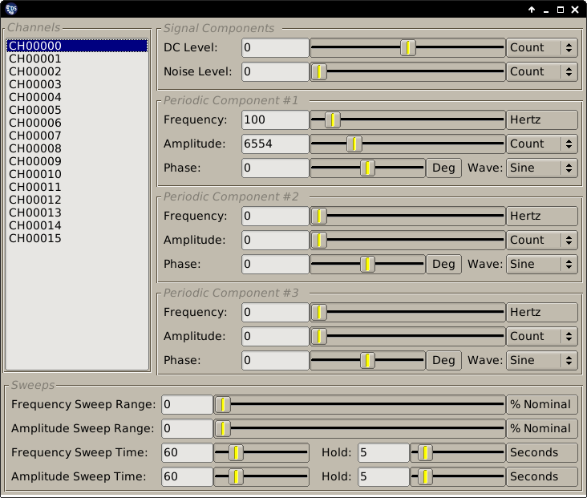

# Simulator Dialog

APEX DS has a built-in data simulator that can be used to generate input data
for training or checking out test configurations. The simulator generates data
samples that are the sum of one DC, one random noise and three periodic
components. All parameters for the generated signal are user controllable,
including the frequency, amplitude, phase and waveform of the periodic
components, and the magnitude of the noise and DC components. The simulator also
supports frequency and amplitude sweeps with user defined sweep ranges and
times.

*Example simulator window*

The data simulator is controlled by the user interface panel shown
above. It has the following controls:

1. The list of signals is shown on the left. One or more channels can be
  selected here. Any changes performed on the panel are applied to the
  selected channels.
2. The group of sliders in the center controls the data generated for
  the selected channel(s). All amplitudes are displayed as
  raw ADC counts (the input sliders are set up for a 16 bit A/D device,
  they cover the -32768 to 32767 range).
3. The sweep range and timing controls are located at the bottom of the panel.
  Sweep ranges are calibrated in percentages of the nominal frequencies
  and amplitudes.

> [!NOTE]
> The simulator remembers its settings between DS invocations. These are saved
> in the project file.
