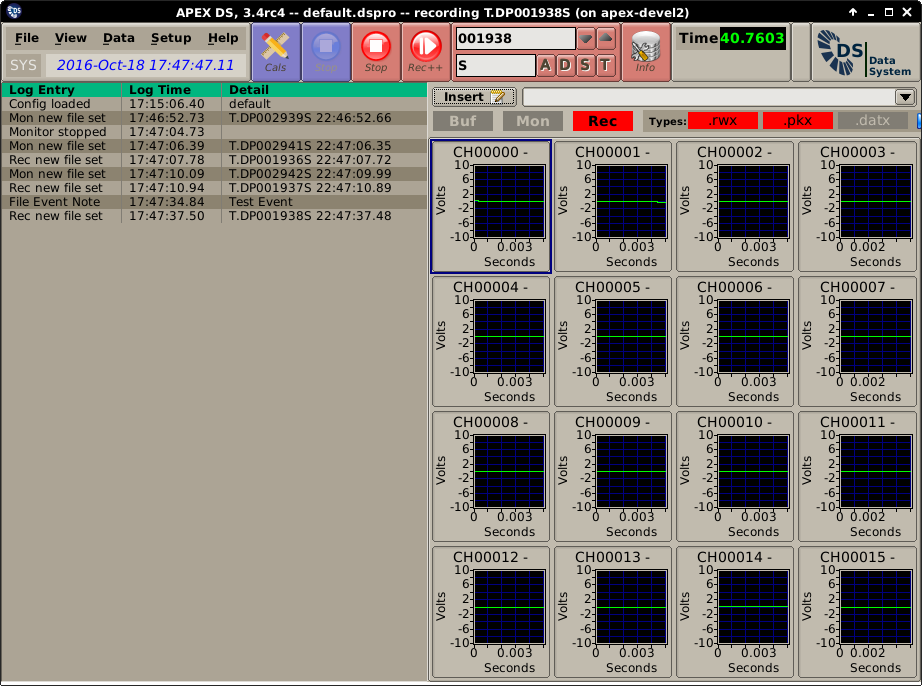

# Test Ops View

*Example Test Ops View*

The Test Ops panel is intended to be a simple, auto-configuring panel that provides just enough functionality to monitor data signals and monitor system status.
The plots on the Test Ops panel are auto generated based on the loaded setup. They are configured in a evenly distributed NxM grid of Time plots.
Double clicking on the plot provides a zoomed in view of the single channel. The zoomed in view is a 2x1 grid with a Time,Mag/Env plot.
Double clicking on a zoomed in channel returns the user to the overall N by M grid of time plots.
|
The area above the plots provides system indicators and controls:

> - Insert: Place event note text into recorded data file; tag with the closest block number number.
> - Buf: Data files are being recorded in a buffered mode, meaning old monitor data is removed per setup panel.
> - Mon: Data files are being recorded in the monitor mode.
> - Rec: Data files are being recorded in the record mode.
> - Disk Usage: Percent of data disk that is used, if using dual write capability reports the disk with the least available space.
> - Types: Indicates which data file types are being recorded in the current mode. This can change between record and monitor.
> - Duration: Indicates time in seconds since the last data file was started.
> - Write Rate: Indicates the write rate in MB/sec to the data disk. This includes any and all disk write activity.
> - Time Avail: Time left assuming continuous record at the same rate.

- **Log Area:**: - Log Entry: Text indicating change in recording state, setup change and event note.
- - **Log Time: Time log entry occurred, tagged with the local system clock, adjusted for local time.**: - Detail: Depending on log type indicated additional information regarding the event per table below.

| Log Entry Text | Detail |
| --- | --- |
| Config loaded | configuration name |
| Mon new file set | [data file base name]  [file start time stamp, no tz adjust] |
| Rec new file set | [data file base name]  [file start time stamp, no tz adjust] |
| Monitor stopped | None |
