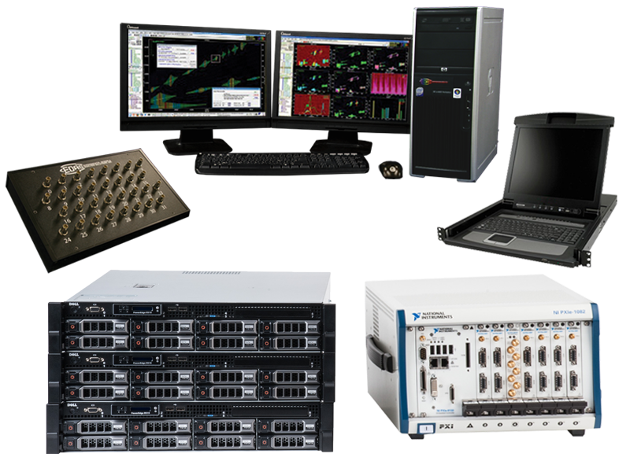

# Hardware

APEX DS systems are high speed high, high channel count data acquisition and
monitoring systems built from commercially available components. APEX, Inc. can
provide pre-configured "turn key" systems or can supply only the software to be
installed on the user's hardware. Various hardware configurations are supported,
including:

- PCI or PCIe (PCI Express) systems in either rack mounted or desktop
  configurations.
- PXI or PXIe systems using either embedded or external controllers.
- Standard "PC" (laptop or desktop) systems using external acquisition modules
  with various interfaces such as USB, Ethernet or some form of "bus expansion"
  chassis (Thunderbolt, PCI, PCIe, PXI or PXIe).

*Example hardware systems supported by APEX DS*

## Analog Input Hardware

In analog input mode the APEX DS system implements all stages of the
data acquisition from analog signal all the way to processed digital
data. It is fully in control of the data acquisition hardware. This
means that besides the actual data collection, all hardware
configuration and control functions are also implemented by APEX DS.
Different types of ADCs (Analog to Digital Converters) are supported in
this mode, below is a comparison of their features:

- **Multiplexed ADCs**: These are devices that have a single analog to
  digital converter and a switching circuitry that multiplexes the
  input of this converter between multiple channels. Typical features:
  - Least expensive, but also the lowest quality input option.
  - Up to 128 channels per device, 14 or 16 bit precision, up to a few
    million samples per second aggregate sample rate.
  - Channel count vs. bandwidth trade-offs are possible as the
    available bandwidth is distributed between channels.
  - Not suitable for phase measurements as each channel is sampled at
    a different time.
  - No anti-aliasing.
- **Simultaneous sampling ADCs**: These devices have an independent
  analog to digital converter for each channel. Typical features:
  - Moderately expensive.
  - Up to 64 channels per device, typically 16 bit precision, up to
    500kHz sample rate.
  - Highest quality data input (less noise, better linearity, etc.).
  - Suitable for phase measurements as each channel is sampled at the
    same time.
  - No anti-aliasing.
- **Sigma-delta ADCs**: These devices have an independent high speed but low
  bit count (typically 12 or less) analog to digital converter for each
  channel. The input signal is sampled at some multiple of the final sample
  rate and digitally filtered to provide a more accurate (higher bit count) but
  lower frequency output. Features:
  - Most expensive.
  - Up to 32 channels per device, 16..24 bit precision, up to 200kHz
    sample rate.
  - Typically more noisy than simultaneous sampling ADCs.
  - Suitable for phase measurements as each channel is sampled at the
    same time.
  - Provides anti-aliasing.
  - The effect of the anti-aliasing filter is typically visible near
    the Nyquist rate (starting between 80..95% of Nyquist).

The input circuitry of some analog to digital converters is not suitable
for interfacing them directly to common dynamic sensor types (strain
gauges, accelerometers, piezo sensors, etc..). Such sensors typically require
power in the form of voltage or current excitation and will provide low
level outputs that need to be amplified to be compatible with the inputs
of the converter.

However. many recent acquisition devices include a configurable preamplifier
stage that allows directly interfacing them to various sensor types (IEPE,
strain gauges, charge, etc..). Most such acquisition devices have user
configurable analog input settings such as gain, excitation, bridge completion,
etc.. The APEX DS software will fully support all available settings on such
devices.

> [!NOTE]
> It is highly recommended to become familiar with the particular hardware
> configuration before the system is used for data acquisition. The Appendix
> contains information on some of the more common supported ADCs and signal
> conditioning devices.

## Digital Inputs

APEX DS can also act as a monitoring system for digital data streams. The
key difference in this case is that the actual data acquisition is
performed by some *external system*, APEX DS only has access to the
already digitized data. In this case APEX DS may have incomplete control
over the data acquisition process, so in some cases compromises (data
loss, incomplete knowledge of the acquisition parameters, etc.) are to
be expected. Typical usage scenarios for this case include:

- Ethernet interfaced devices. In this case the manufacturer packages the ADC
  hardware with an embedded controller that provides some form of network
  interface for configuration and data streaming. Configuration may be
  performed by the APEX DS application or an external utility.
- Monitoring a digital data stream provided over a network interface by
  some other manufacturer's complete data acquisition system. Examples are
  digital telemetry systems or some digital data recorders that have
  real-time data streaming capability.

## Extensible Device Support

APEX DS uses a modular driver architecture for supporting acquisition devices
from many different manufacturers. For each supported device type (or groups of
similar devices) APEX maintains a separate "plug-in" driver package that has to
be added to the "standard" APEX DS installation. This way different users with
different hardware configurations can customize their software installation
according to their needs.

> [!NOTE]
> Driver plug-ins for new devices can be created either by APEX (upon request)
> or by users themselves. For the second case the APEX DS API package contains
> all the necessary documentation, software interfaces and examples.
