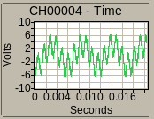
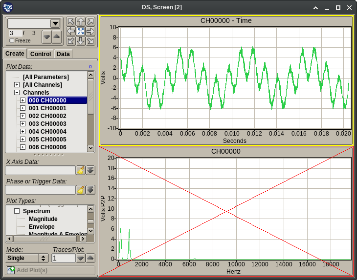
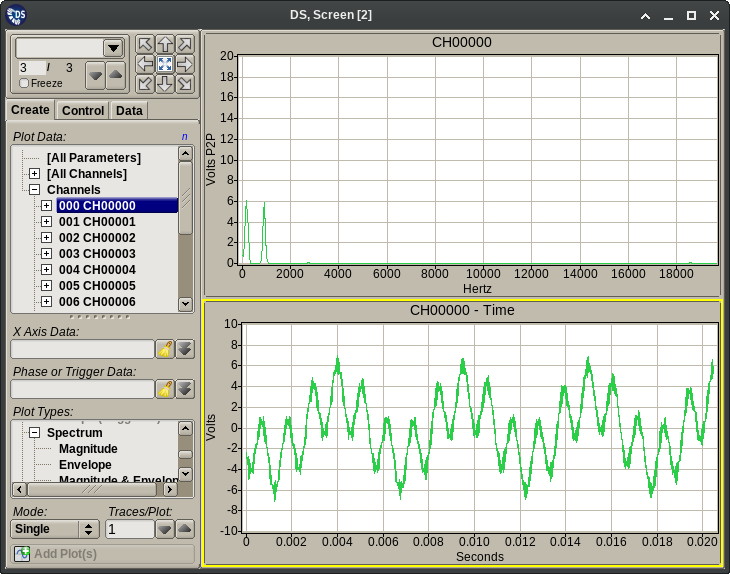
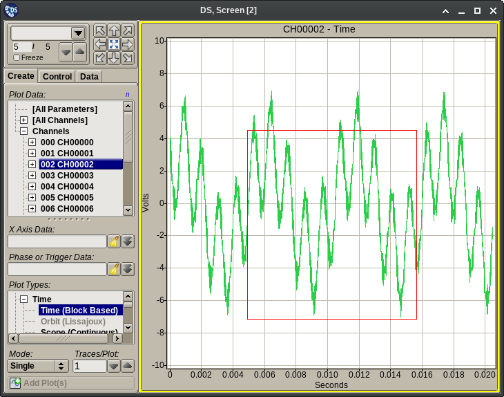
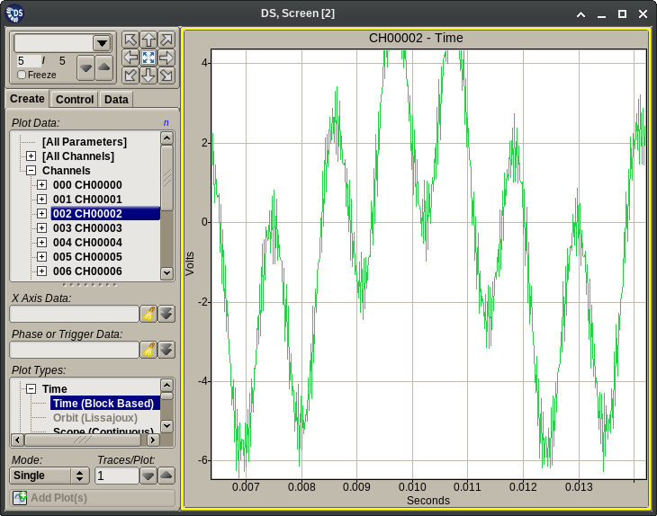
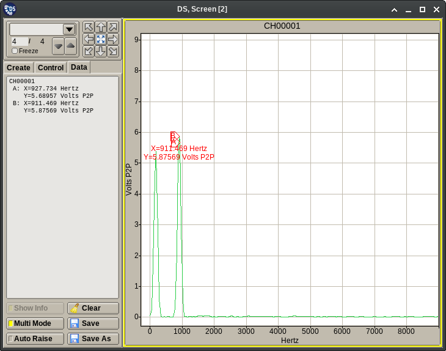

# Plot Interactions

Most data plots of the APEX DS application support several different ways for
the user to interactively manipulate them.  This section will describe the
*standard* mechanisms that are supported by (almost) all plots. Additional
methods may be supported by certain plot types. These will be described in their
respective sections.

A typical APEX DS plot has different areas to interact with, possibly with different results:

> - The **data** area of the plot is the inside of the inner plot frame where one or more data curves are drawn.
> - The **title** area of the plot is the space between the inner and outer frames at the top of the plot.
> - The **axis** areas of the plot are the spaces between the plot axes (X, Y, and for some plots a second Y axis on the right)
>   and the outer frame at the bottom and side(s) of the plot.

## Plot Selection

A mouse click with any button anywhere inside the plot cell's outer frame will
select the plot cell. Cells can be selected regardless of whether they are empty
or display a plot. Depending on the mouse button used and some keyboard
modifiers the following effects are possible:

> - A click with the **primary** (left) mouse button will select the target plot cell exclusively. Any previous selections will be undone.
> - A primary button click with the **Control** key held down will toggle the target cell's selection status.
> - A primary button click with the **Shift** key held down will extend the selection to all cells between the target cell and the last selected one.
> - A **secondary** (right) button click will select the target plot followed by the display of the Plot Menu which will be described in the next section.

> [!TIP]
> If the target cell is not empty and if the only goal is to select the plot,
> then it is best to click over the title area. This will avoid unintended side
> effects.

## Arranging Plots

An initial mouse button press over a non-empty plot cell's title area can be
followed by a dragging action with the button continuously held down. This
will allow moving the selected plot to a different plot grid cell. Upon
releasing the button the move will be completed.

| Item | Details |
| --- | --- |
|  _Before_ |  _After_ |

## Plot Zooming

An initial mouse button press over a non-empty plot cell's data area can be
followed by a dragging action with the button continuously held down. This will
draw a temporary selection box over the plot's data. Upon releasing the button
the plot's axis scaling will be temporarily changed to display only the selected
area. This zooming action can be repeated multiple times. The original (i.e.
**not** the previously zoomed) plot scaling can be restored from the Plot Menu
described in the next section.

| Item | Details |
| --- | --- |
|  _Before_ |  _After_ |

## Plot Cursors

Clicking inside a non-empty plot cell's data area adjacent (within a few pixels)
to a data curve point will place a cursor on that  plot. The cursor's numerical
read out will be added to the Data Tab described in the previous section, and
depending on the plot type and available display space  the text may also be
shown on the plot itself.

*Example Plot with Cursors*

Additional cursor types may be supported by certain plot types. These will be
described in their respective sections.
