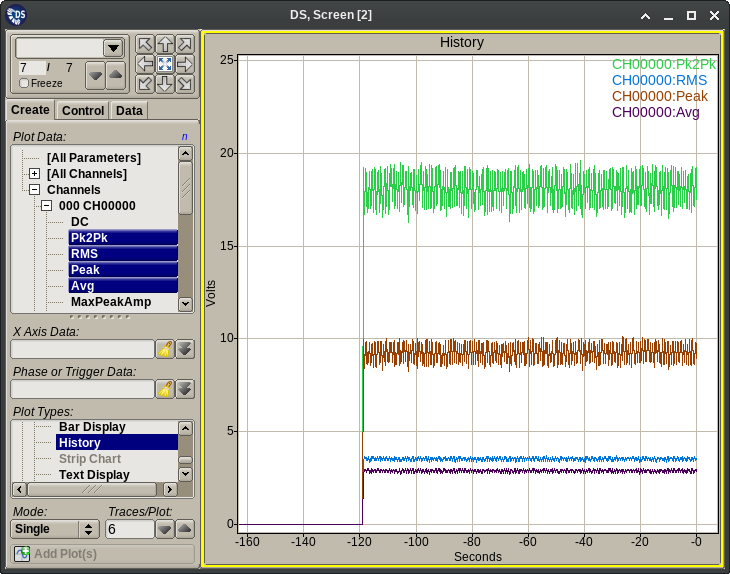

# History Plots

History Plots display long term collected values for one or more
parameters or channel stats. These plots:

> - Require the selection of the following items on the [plotcreate-link](#plotcreate-link) tab
>   before adding them to the plot grid:
>
>   > - One or more primary parameters or channel stats.
>   > - Optionally, one parameter or channel stat to use as the X axis value instead of time.
> - Do **not** extend the [plotmenu-link](#plotmenu-link) with additional choices.
> - Do **not** add extra pages to the [plotsetup-link](#plotsetup-link) dialog.
> - Provide **no** additional user interaction mechanisms beyond the 'standard' ones
>   described in the [plotactions-link](#plotactions-link) section.

*Example History Plot*

Time values displayed on the X axis (when not overridden) are negative,
indicating that those values are from the past. History plots with a default
X axis will scroll to the left as monitoring progresses. The time (or
equivalent block) range of all history plots is equal to the value configured
under the [setupstorage-link](#setupstorage-link) tab of the APEX DS Setup Editor
dialog.
