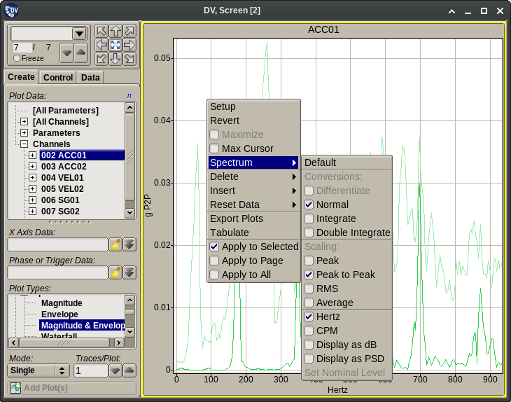

# Spectrum Plots

Spectrum Plots display the FFT computed from the current data block's samples
for one or more channels. These plots:

> - Require the selection of the following items on the [plotcreate-link](#plotcreate-link) tab
>   before adding them to the plot grid:
>
>   > - One or more primary data channels.
>   > - Optional order based cursor specification(s) on the Trigger/Phase input.
> - Extend the [plotmenu-link](#plotmenu-link) with an additional sub-menu described below.
> - Do **not** add extra pages to the [plotsetup-link](#plotsetup-link) dialog.
> - Provide an additional user interaction mechanisms beyond the 'standard' ones
>   described in the [plotactions-link](#plotactions-link) section. This allows users to place
>   fixed frequency cursors on the X axis as described below.



*Example Spectrum Plot and Menu*

Spectrum plots have three sub-types depending of the data curve being displayed:

- **Magnitude** plots display the instantaneous FFT spectrum for each data block.
- **Envelope** plots display the historical maximum (peak hold) of the FFT spectrum
  for each frequency value.
- **Magnitude&Envelope** plots display both curves listed above.

Spectrum plots provide additional cursor types beyond the standard ones
introduced earlier. These cursors are drawn as vertical lines at a given X axis
position and will display the numerical values of all data curve intersects at
that X (frequency) value. These X axis cursors have three sub-types:

- **Fixed Frequency** cursors can be created by clicking inside the plot's X
  axis area. Once created, fixed cursors can be  removed by clicking on their
  triangular markers below the X axis. They can also be moved to a different
  frequency value by dragging the same markers horizontally.
- The **Maximum Peak** cursor can be enabled or disabled on the right click
  pop-up menu  invoked over a selected spectrum plot. These will be drawn at the
  location of the biggest FFT peak.
- **Order** (or EO) cursors can be added at plot creation time by specifying the list
  of desired speed parameters and order values on the "Trigger or Phase" input
  of the plot creation tab. The list can be space or comma separated and has to contain EO
  cursor specifications in one of the following forms:

  ```
  Speed1:Order1 Speed2:Order2 ...
  Speed1 Speed2 ...
  Order1 Order2 ...
  ```

  The first form specifies both the speed parameter and the order value used to
  calculate the cursor's frequency. The second form will display first order
  cursors for all listed speed parameters. The third form is accepted only if
  the channel(s) have a  default reference parameter (must be speed) assigned to them, which is
  then combined with the listed order numbers.

The Plot Menu extension displayed for spectrum plots provides the following functionality:

- **Max Cursor:** Toggles display of the X axis cursor drawn at the maximum spectrum peak location.
- **Default:** Resets all the options configurable on this menu to their default values.
- Domain conversion options. These are performed on a per plot basis and require a properly configured [integrationtable-link](#integrationtable-link).
  - **Differentiate:** Display the plot's data curves in the differentiated domain. (Example: displacement to speed.)
  - **Normal:** Display the plot's data curves without any domain change.
  - **Integrate:** Display the plot's curves in the integrated domain. (Example: speed to displacement.)
  - **Double Integrate:** Display the plot's curves in the double integrated domain. (Example: acceleration to displacement.)
- Scaling options. These allow the spectrum to be displayed using scaling options different from the channel's default configuration.
  - **Peak:** Display the plot's FFT data scaled as peak amplitude.
  - **Peak to Peak:** Display the plot's FFT data scaled as peak to peak amplitude.
  - **RMS:** Display the plot's FFT data scaled as mean square average amplitude.
  - **Average:** Display the plot's FFT data scaled as linear average amplitude.
  - **Hertz:** Scale the plot's X axis in Hertz units.
  - **CPM:** Scale the plot's X axis in CPM (Cycles Per Minute) units.
  - **Display as dB:** Scale the plot's Y axis in decibel units.
  - **Display as PSD:** Scale the plot's Y axis in PSD (Power Spectral Density) units.
- **Set Nominal Level:** Available in dB scaled mode only. Sets the data level that corresponds to 0 dB.

> [!NOTE]
> The data curves displayed on these plots are the result of combining the FFT
> and peak data produced  by the APEX DS data processor. This will insert
> extra points between the regularly spaced FFT values at the locations of the
> extracted and interpolated peaks.

> [!TIP]
> Spectrum plots will display the limits associated with the assigned data
> channel. For limits to be  visible a properly configured limit file must be
> loaded into the application. Also, limits are  only shown on plots that
> display a single channel.
