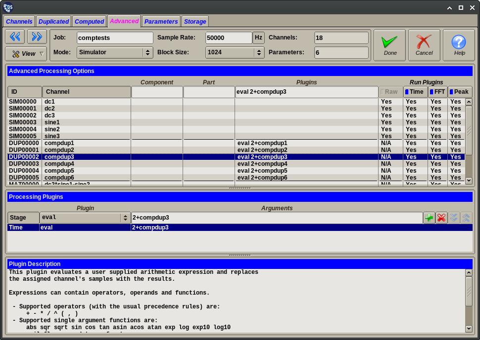

# Advanced Tab

The Setup Editor Advanced tab is mainly used to integrate optional plugins
into the processing configuration of signal channels.

*Example Setup Editor Advanced tab*

This panel displays all channels regardless of their source (input, duplicated or computed)
and allows editing plugins and some documentation-only text fields. Only channels processed
as signals are shown, unused, parameter or IRIG channels are excluded from this panel.

The plugins that can be added on this panel are defined in the [setupplugins-link](#setupplugins-link) Section.

The editor is based on a table of displayed channels. One or more lines can be
selected in the table. Column values can be changed for all selected table lines
by using the input fields on the header row. The following columns are defined
for this panel:

| Column | Accepted Value | Description |
| --- | --- | --- |
| ID | Not editable | Internally generated ID |
| Channel | Not editable | Channel name as entered on the defining tab |
| Component | Any Text | For documentation purposes only |
| Part | Any Text | For documentation purposes only |
| Plugins | Multi-line text | Plugin name + arguments, one per line |
| Run Plugins | On/Off Switches | Control the execution of plugins at various stages |

Single line plugin specifications can be entered directly on the table header controls.
For more complex or multi-plugin cases the bottom half of the panel also
provides an *assisted editor*. This allows editing the plugin specification text on a line by line basis and
supports insertion, removal or modification of per plugin text lines.

A pull-doewn menu of all available plugins is also provided. Selecting an entry on this will update
the plugin specific information text displayed below the multi-line editor area. In most cases a deault argument
template text is also displayed.

> [!TIP]
> Plugin text lines beginning with the '#' character are treated as comments.
