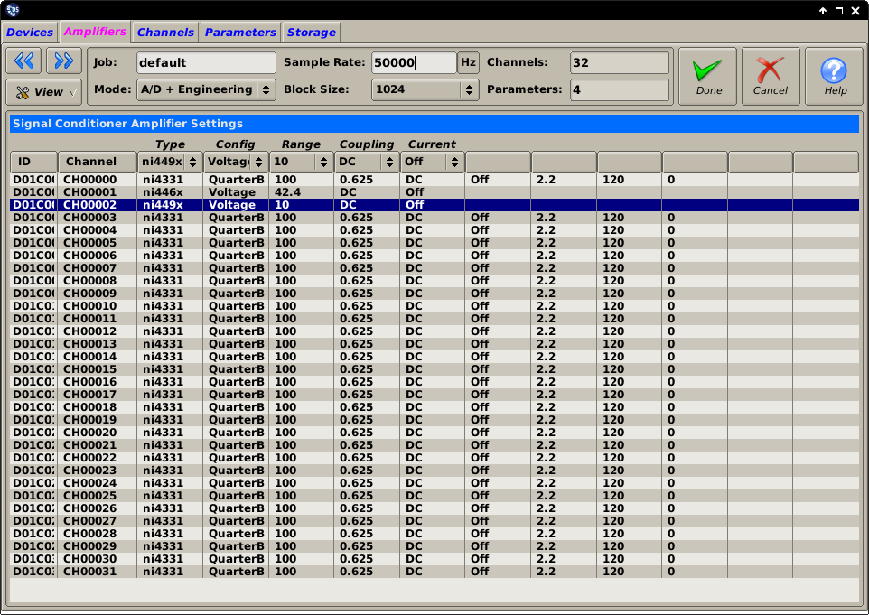

# Amplifiers Tab

The Setup Editor Amplifiers tab allows users to adjust per channel analog input
options. This tab is only displayed if at least one configured input device has
such options. All columns after the "**Config**" column are dynamic and populated with
the appropriate settings based on the actual device type that has been selected.

Refer to your hardware manual for the specific settings and usages.

*Example Setup Editor Amplifiers tab*

The editor is based on a table of displayed channels. One or more lines can be
selected in the table. Column values can be changed for all selected table lines
by using the input fields on the header row. The following columns are defined
for the panel:

| Column | Accepted Value | Description |
| --- | --- | --- |
| ID | Not editable | Internally generated ID |
| Channel | Real channel name | Defined on the Channels tab |
| Type | Type of device channel | Fixed on some devices, to be configured otherwise. |
| Config | Channel configuration | Fixed on some devices, to be configured otherwise. |
| ... |  | Device type and mode specific columns |

> [!TIP]
> Multiple **Type** column choices typically indicate different available
> measurement modes for the device channel such as voltage, IEPE, bridge, etc..

> [!TIP]
> Multiple **Config** column choices typically indicate different configuration
> options within a measurement mode such as quarter bridge, half bridge, etc..
