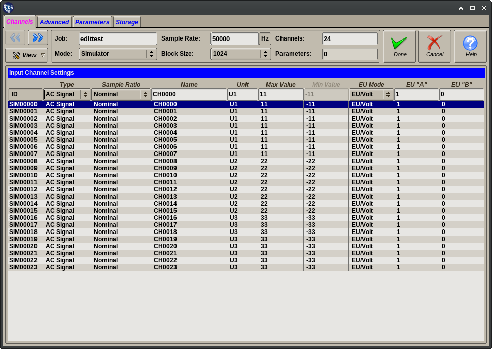

# Channels Tab

The Setup Editor Channels tab page configures the acquisition and processing
options of channels that are measured by the configured input device(s) or
generated by the DS data simulator. These are the channels that are
recorded in the raw format data files.

*Example Setup Editor Channels tab*

In the simulated input mode the channel count is editable in the
[setupcommon-link](#setupcommon-link) area of the editor. Otherwise the channel count  is
determined on the [setupdevices-link](#setupdevices-link) as the sum of all configured device
channels.

The editor is based on a table of displayed channels. One or more lines can be
selected in the table. Column values can be changed for all selected table lines
by using the input fields on the header row. The following columns are defined
for the panel:

<table>
  <thead>
    <tr>
      <th>Column</th>
      <th>Accepted Value</th>
      <th>Description</th>
    </tr>
  </thead>
  <tbody>
    <tr>
      <td>ID</td>
      <td>Not changeable</td>
      <td>Internally generated ID</td>
    </tr>
    <tr>
      <td rowspan="7">Type</td>
      <td>Unused</td>
      <td>Channel is acquired but not processed</td>
    </tr>
    <tr>
      <td>DC Signal</td>
      <td>Channel will be processed as signal with DC coupling</td>
    </tr>
    <tr>
      <td>AC Signal</td>
      <td>Channel will have a software based DC removal applied</td>
    </tr>
    <tr>
      <td>Parameter</td>
      <td>Channel will be treated as a DC level parameter</td>
    </tr>
    <tr>
      <td>Speed</td>
      <td>Channel will be decoded as a AC speed, see Tach scaling</td>
    </tr>
    <tr>
      <td>Speed (DC)</td>
      <td>Channel will be treated as a DC speed</td>
    </tr>
    <tr>
      <td>IRIG</td>
      <td>Channel will be decoded as an IRIG signal</td>
    </tr>
    <tr>
      <td rowspan="9">Sample Ratio</td>
      <td>16x Down</td>
      <td>Set sample rate for this channel to 1/16th the base rate</td>
    </tr>
    <tr>
      <td>8x Down</td>
      <td>Set sample rate for this channel to 1/8th the base rate</td>
    </tr>
    <tr>
      <td>4x Down</td>
      <td>Set sample rate for this channel to 1/4th the base rate</td>
    </tr>
    <tr>
      <td>2x Down</td>
      <td>Set sample rate for this channel to 1/2th the base rate</td>
    </tr>
    <tr>
      <td>Nominal</td>
      <td>Leave sample rate at the base rate</td>
    </tr>
    <tr>
      <td>2x Up</td>
      <td>Set sample rate for this channel to 2x the base rate</td>
    </tr>
    <tr>
      <td>4x Up</td>
      <td>Set sample rate for this channel to 4x the base rate</td>
    </tr>
    <tr>
      <td>8x Up</td>
      <td>Set sample rate for this channel to 8x the base rate</td>
    </tr>
    <tr>
      <td>16x Up</td>
      <td>Set sample rate for this channel to 16x the base rate</td>
    </tr>
    <tr>
      <td colspan="3">*The subsequent columns are not configurable for unused channels or ones processed as IRIG*</td>
    </tr>
    <tr>
      <td>Name</td>
      <td>Free form text</td>
      <td>Text that will be used to identify channel</td>
    </tr>
    <tr>
      <td>Unit</td>
      <td>Free form text</td>
      <td>Text that will be used to indicate channel units</td>
    </tr>
    <tr>
      <td>Max Value</td>
      <td>Real number between (1E-37 1E+37)</td>
      <td>Default maximum value used to for display purposes</td>
    </tr>
    <tr>
      <td colspan="3">*The subsequent columns are displayed when the channel is used as a signal or "generic" (DC) parameter*</td>
    </tr>
    <tr>
      <td>Min Value</td>
      <td>Real number between (1E-37 1E+37)</td>
      <td>Default minimum value used to for display purposes</td>
    </tr>
    <tr>
      <td rowspan="3">EU Mode</td>
      <td>EU/Raw</td>
      <td>EU A/B are applied to the raw counts</td>
    </tr>
    <tr>
      <td>EU/Volt</td>
      <td>EU A/B are applied to the volts</td>
    </tr>
    <tr>
      <td>EU/Sensor</td>
      <td>EU A/B are applied to the volts as produced by sensor</td>
    </tr>
    <tr>
      <td>EU "A"</td>
      <td>Real number between (1E-37 1E+37)</td>
      <td>Scale factor for conversion to engineering units</td>
    </tr>
    <tr>
      <td>EU "B"</td>
      <td>Real number between (1E-37 1E+37)</td>
      <td>Offset for conversion to engineering units</td>
    </tr>
    <tr>
      <td colspan="3">*The subsequent columns are displayed when the channel is used as speed (tachometer input) channel*</td>
    </tr>
    <tr>
      <td rowspan="2">Scaling</td>
      <td>N *(pulses per revolution)*</td>
      <td>Pulses per revolution</td>
    </tr>
    <tr>
      <td>R *(tach ratio)*</td>
      <td>Conversion factor from measured frequency (Hz) to RPM</td>
    </tr>
    <tr>
      <td rowspan="2">Level/Edge</td>
      <td>% of dynamic input range</td>
      <td>Level at which analog input triggers a tach pulse</td>
    </tr>
    <tr>
      <td>R *(rising)* F *(falling)* or D</td>
      <td>Edge for analog input triggering or enable digital input</td>
    </tr>
    <tr>
      <td rowspan="2">Detection</td>
      <td>Minimum Pk2Pk level for decoding</td>
      <td>Analog signal level below which no output is generated</td>
    </tr>
    <tr>
      <td>V *(Volts)* or N *(ADC counts)*</td>
      <td>Determines how detection threshold is interpreted</td>
    </tr>
    <tr>
      <td>Averaging</td>
      <td>Numeric input for time interval</td>
      <td>RPM calculation averages tach pulse distances over this</td>
    </tr>
  </tbody>
</table>

> [!WARNING]
> Channels of type "Speed" use the **Max Value** field to determine the minimum
> pulse interval. This is used to reject "false duplicate" pulses. If the
> decoded speed is over 120% of the maximum value there will be no further
> increase in displayed speed.

> [!WARNING]
> The **Sample Ratio** values must be supportable by the ADC Device(s) in use.
> Most DS supported devices do not support different rates on adjacent
> channels. But in most cases different devices of the same type used in
> multi-device configurations can be set to different rates.
