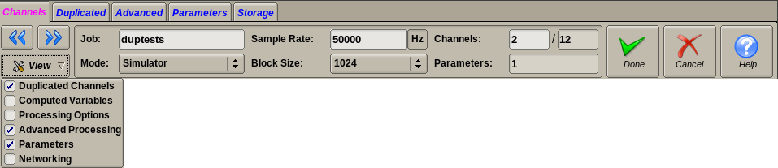

# Common Settings

The Common Settings area is always visible in the APEX DS Setup Editor,
regardless of the currently displayed page.  It allows the user to apply
(**Done**) or abandon (**Cancel**) the changes made in the current editing
session.

*Example Setup Editor Common Area*

This area also allows editing the most common acquisition setup options:

| Item | Description |
| --- | --- |
| Job: | Text string used to identify system or test name |
| Input: | Simulator or A/D device, selecting A/D device enables panel to configure devices |
| Sample Rate: | Desired base sample rate of AD device, validated on panel "Done" |
| Block Size: | Number of samples used for time domain and FFT processing (assuming no overlap) |
| Channels: | Number of configured channels |
| Parameters: | Number of configured parameters |

> [!TIP]
> The channel and parameter count display/entry fields may be shown as a single
> field or as split fields. This depends on whether the channels or parameters
> shown on the currently displayed page are a subset of their respective totals
> or not.

Finally, the Common Area also provides the selection mechanisms for accessing
all editor  pages. Pages can be accessed either by using the tabs at the top or
by using the  navigation buttons in the top left corner. The **View** pull-down
can be used to enable or disable additional editor pages:

The "**Devices**" and ""**Amplifiers**" editor pages are automatically added or
removed based on input mode and device selections. For the other, mostly
processing related optional tabs the rule is that they are automatically
displayed and are **not** removable if the edited configuration already contains
features configurable on these. Otherwise the pull-down can be used to display
them.
