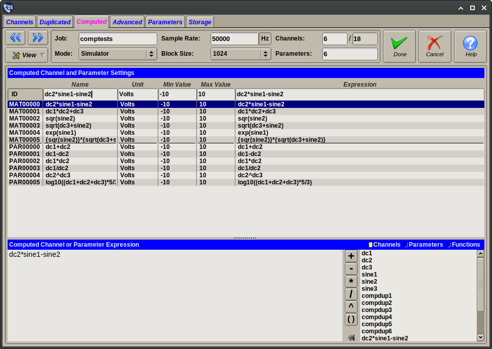

# Computed Tab

The Setup Editor Computed tab supports the creation of additional channels or
parameters whose data is computed by evaluating an arithmetic expression.

*Setup Editor Computed tab*

The computed channel and parameter counts are editable in the
[setupcommon-link](#setupcommon-link) area of the editor. The expression evaluator supports:

> - The usual arithmetic operators (add, subtract, multiply, divide, power).
> - Channel, parameter and channel stat operands.
> - Numeric constants.
> - Common math functions.
> - Parentheses to change default operator precedence rules.

The editor is based on a table of displayed channels and parameters. One or more lines can be
selected in the table. Column values can be changed for all selected table lines
by using the input fields on the header row. The following columns are defined
for this panel:

| Column | Accepted Value | Description |
| --- | --- | --- |
| ID | Not changeable | Internally generated ID |
| Name | Free form text | Text that will be used to identify channel or parameter |
| Unit | Free form text | Text that will be used to indicate units |
| Min Value | Real number between (1E-37 1E+37) | Default minimum value used to for display purposes |
| Max Value | Real number between (1E-37 1E+37) | Default maximum value used to for display purposes |
| Expression | Test input in the proper syntax | Expression to evaluate when generating data values |

Single line expressions can be entered directly on the table header controls.
For more complex or multi-line  expressions the bottom half of the panel also
provides an *assisted editor*. This allows entering the expression in  a
multi-line format and also provides buttons and lists that display all the
operator, function, channel and parameter names as a reminder to the user.
Clicking on any of these elements will insert the appropriate text into the
expression being edited.

In case channel or parameter names contain characters that are recognized by the
expression parser (white space, one of "+-*/^()") then the operand name must
be enclosed in curly braces ({}).

> [!WARNING]
> Expressions are validated when the edited configuration is being applied
> after closing the Setup Editor. Syntax errors, undefined operands or
> circular expression dependencies will be reported at that time.

> [!NOTE]
> - The sample ratio of computed channels is not directly settable. It will be
>   set to the highest sample ratio of all expression operands.
> - The type of all computed channels is "DC Signal".
> - The type of computed parameters is settable on the [setupparams-link](#setupparams-link).
