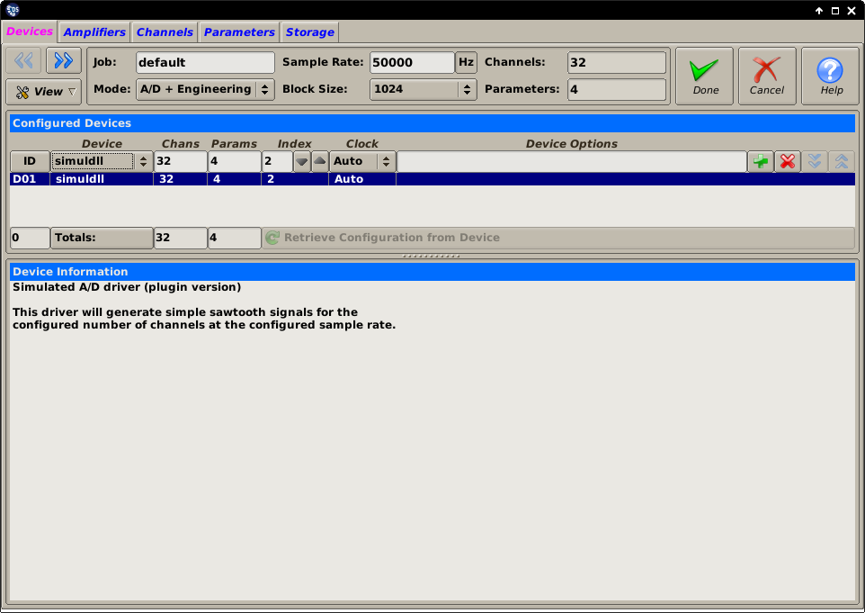

# Devices Tab

The Devices tab of the Setup Editor allows users to configure input devices. The
general procedure for configuring a device is as follows:

1. Determine proper driver for you hardware.
2. Add an entry for each available device in the system using the **+** button.
3. Configure each device including channel and parameter counts, device name or index, multi-device clocking mode (when applicable) and other type specific options.

The device options are presented in the large text area in the bottom half of
the  window. These options are completely dependent on the device being
configured. Text entered in the device options will override the "**Clock**" and
"**Index**" GUI elements shown for each card.

*Example Setup Editor Devices tab*
