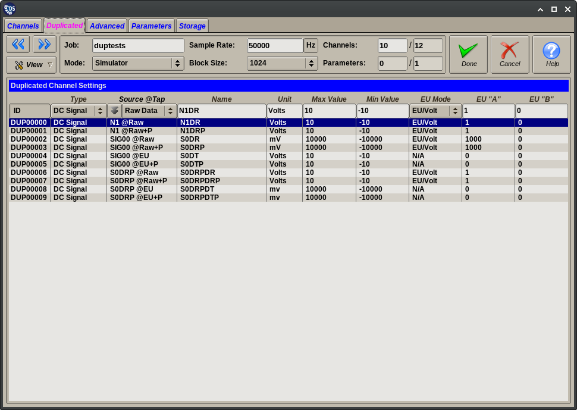

# Duplicated Tab

The Setup Editor Duplicated tab page configures the acquisition and processing
options of channels whose data is copied from an other channel at some stage of
their processing. These channels are not present in the raw
format data files.

*Example Setup Editor Duplicated tab*

The count of duplicated channels is editable in the [setupcommon-link](#setupcommon-link)
area of the editor. The Duplicated tab itself is an almost exact copy of the
[setupchannels-link](#setupchannels-link) tab. See table column definitions there. The
difference is that the **Sample Ratio** column of that tab has been replaced
with a column that allows the selection of the source channel and the processing
stage where the duplication occurs. The possible duplication stages are:

- Raw data before the raw plugins.
- Raw data after the raw plugins.
- Time (EU converted) data before the time plugins.
- Time (EU converted) data after the time plugins.

> [!TIP]
> For channels duplicated at the "time" stages above editing the EU conversion
> related columns will be deactivated.

> [!WARNING]
> There are a few "*impossible*" duplicated channel combinations. For example: It is
> not possible to duplicate a source channel processed as IRIG or parameter at
> any of the "time" stages. These combinations will be flagged as an error when
> attempting to apply the edited setup.
