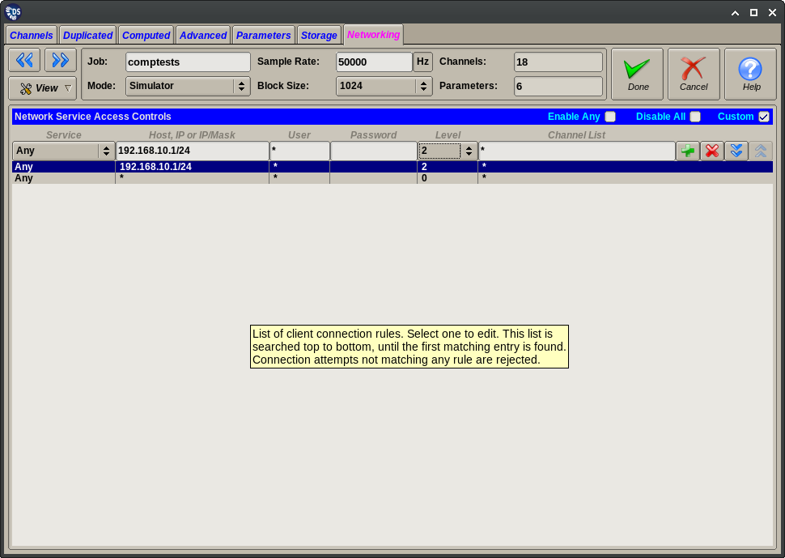

# Networking Tab

The Setup Editor Networking tab supports adding access rules for control or
monitoring mode clients attempting to connect to a running APEX DS acquisition
system.

*Example Setup Editor Networking tab*

This panel can enable or disable all client access or it can specify custom
access rules to be implemented by the APEX DS data server. The custom rules have
two parts:

> - A **filtering** specification that determines whether a rule applies to an
>   incoming connection request or not. Filters can be based on  host names, IP-s,
>   user names, passwords, etc..
> - Am **access** specification that may limit the priority levels or data items
>   available to a client allowed to connect under the matching rule.

Clients attempting to connect can be one of two types:

> - **Streaming** clients can only receive data from the connected APEX DS
>   server. There is no limit on the number of allowed streaming client
>   connections.
> - **Manager** mode clients can stream data, but in addition they can also
>   control the  data acquisition, monitoring and recording modes of the
>   connected server. APEX DS servers  only allow a **single** monitor mode
>   connection at a time. Further attempts will be rejected, even if the access
>   rules allow them.

Custom rules are tried top to bottom. If no rule is found that matches the
incoming request then the connection attempt is rejected. Otherwise the
connection is allowed under the access rules specified in the **first** matching
rule.

Custom rules have the following attributes:

<table>
  <thead>
    <tr>
      <th>Column</th>
      <th>Accepted Value</th>
      <th>Description or Example</th>
    </tr>
  </thead>
  <tbody>
    <tr>
      <td rowspan="3">Service</td>
      <td>Any</td>
      <td>Filter: Rule applies to both Stream and Manager clients</td>
    </tr>
    <tr>
      <td>Data</td>
      <td>Filter: Rule applies to only Streaming clients only</td>
    </tr>
    <tr>
      <td>Manager</td>
      <td>Filter: Rule applies to only Manager clients only</td>
    </tr>
    <tr>
      <td rowspan="3">Host,IP,Mask</td>
      <td>Host</td>
      <td>Filter: Rule applies to named host only</td>
    </tr>
    <tr>
      <td>IP</td>
      <td>Filter: Rule applies to given IP address only</td>
    </tr>
    <tr>
      <td>IP/Mask</td>
      <td>Filter: Rule applies to all IPs on the given subnet</td>
    </tr>
    <tr>
      <td>User</td>
      <td>Valid OS user name</td>
      <td>Filter: Rule applies to listed user (running client SW)</td>
    </tr>
    <tr>
      <td>Password</td>
      <td>Free form text</td>
      <td>Filter: Rule applies to clients supplying given password</td>
    </tr>
    <tr>
      <td>Level</td>
      <td>0 .. 5</td>
      <td>Access: Limit client's requested priority level</td>
    </tr>
    <tr>
      <td>Channel List</td>
      <td>List of channels/ranges</td>
      <td>Access: Limit client's access to listed channels only</td>
    </tr>
  </tbody>
</table>

> [!WARNING]
> Clients will be silently rejected if they are not allowed to connect based on
> networking controls.

> [!NOTE]
> These settings apply to both DR clients and user written clients based on the
> DS API. API clients can be either Streaming or Manager clients. DR-s are
> always Streaming only.
