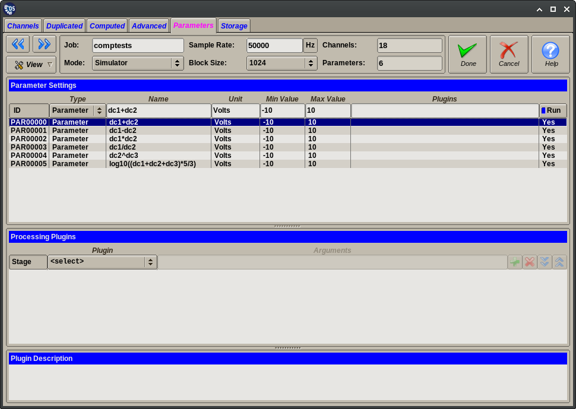

# Parameters Tab

The Setup Editor Parameters tab is used to configure processing and display options
for all parameters defined in the acquisition setup.

*Setup Editor Parameters tab*

This panel displays and configures all parameters defined in the current acquisition setup. Parameters can originate from
multiple sources:

> - **Device Parameters** are produced by some acquisition devices that have both low speed and high speed outputs.
> - **Decoded Parameters** are generated as the output of processing some channels as parameter inputs.
> - **Computed Parameters** are defined as the result of an arithmetic expression on the [setupcomputed-link](#setupcomputed-link).

The editor is based on a table of displayed parameters. One or more lines can be
selected in the table. Column values can be changed for all selected table lines
by using the input fields on the header row. The following columns are defined
for this panel:

<table>
  <thead>
    <tr>
      <th>Column</th>
      <th>Accepted Value</th>
      <th>Description</th>
    </tr>
  </thead>
  <tbody>
    <tr>
      <td>ID</td>
      <td>Not editable</td>
      <td>Internally generated ID</td>
    </tr>
    <tr>
      <td rowspan="4">Type</td>
      <td>Parameter</td>
      <td>Generic parameter measured as DC level</td>
    </tr>
    <tr>
      <td>Speed</td>
      <td>Tach Speed parameter (disabled for Computed)</td>
    </tr>
    <tr>
      <td>Speed (DC)</td>
      <td>Speed parameter measured as DC signal</td>
    </tr>
    <tr>
      <td>Time Code</td>
      <td>Time code parameter (Device source only)</td>
    </tr>
    <tr>
      <td>Name</td>
      <td>Free form text</td>
      <td>Text that will be used to identify parameter</td>
    </tr>
    <tr>
      <td>Unit</td>
      <td>Free form text</td>
      <td>Text that will be used to indicate units</td>
    </tr>
    <tr>
      <td>Min Value</td>
      <td>Real number between (1E-37 1E+37)</td>
      <td>Default min value used to for display purposes</td>
    </tr>
    <tr>
      <td>Max Value</td>
      <td>Real number between (1E-37 1E+37)</td>
      <td>Default max value used to for display purposes</td>
    </tr>
    <tr>
      <td>Plugins</td>
      <td>Multi-line text</td>
      <td>Plugin name + arguments, one per line</td>
    </tr>
    <tr>
      <td>Plugins</td>
      <td>On/Off Switch</td>
      <td>Enable/disable execution of plugins</td>
    </tr>
  </tbody>
</table>

Single line plugin specifications can be entered directly on the table header controls.
For more complex or multi-plugin cases the bottom half of the panel also
provides an *assisted editor*. See the [setupadvanced-link](#setupadvanced-link) for more details.
