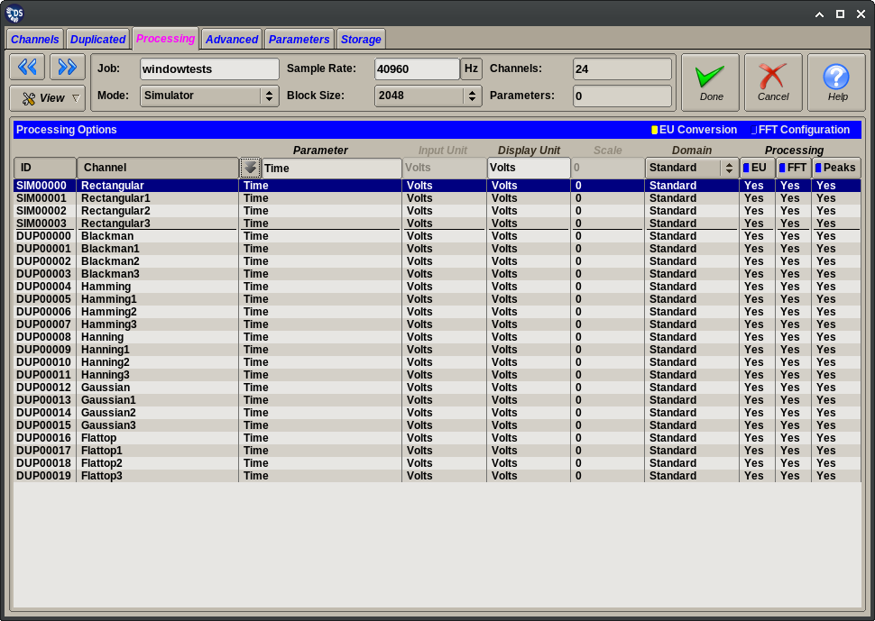
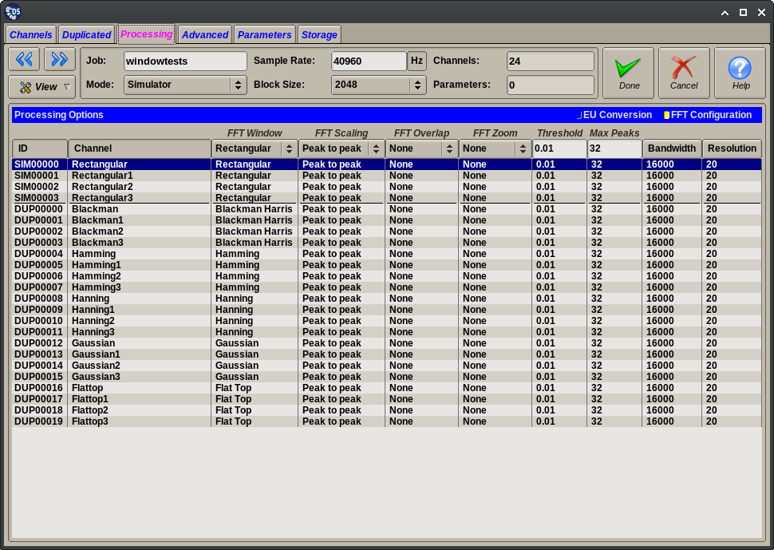

# Processing Tab

The Setup Editor Processing tab allows setting those channel processing options
that can be left unchanged and used with their default values for simple
acquisition tasks.



*Example Setup Editor Processing tab, "*EU Conversion*" view*



*Example Setup Editor Processing tab, "*FFT Settings*" view*

This panel displays all channels regardless of their source (input, duplicated or computed)
and allows editing some less frequently modified processing options. Only channels processed
as signals are shown, unused, parameter or IRIG channels are excluded from this panel. This page
provides two views of the channel processing options:

> - The **EU Conversion** view controls settings that are mostly related to the time domain processing
>   of signal channels:
>
>   > - The default **parameter** assigned to the channel. This is a convenience setting that aids in creating data plots.
>   > - Additional scaling settings that are used when channels are processed in a **domain** different from their measured one.
>   > - Switches that **enable or disable** various stages of the data processing.
> - The **FFT Settings** view controls settings relevant to the frequency domain processing
>   of signal channels.

The editor is based on a table of displayed channels. One or more lines can be
selected in the table. Column values can be changed for all selected table lines
by using the input fields on the header row. The following columns are defined
for this panel:

<table>
  <thead>
    <tr>
      <th>Column</th>
      <th>Accepted Value</th>
      <th>Description</th>
    </tr>
  </thead>
  <tbody>
    <tr>
      <td>ID</td>
      <td>Not editable</td>
      <td>Internally generated ID</td>
    </tr>
    <tr>
      <td>Channel</td>
      <td>Not editable</td>
      <td>Channel name as entered on Channels. Duplicated or Computed tabs</td>
    </tr>
    <tr>
      <td colspan="3">*The following columns are present only in the EU Conversion view*</td>
    </tr>
    <tr>
      <td>Parameter</td>
      <td>Any parameter name</td>
      <td>Parameter that will be the default X-axis for certain plots</td>
    </tr>
    <tr>
      <td>Input Unit</td>
      <td>Free form text</td>
      <td>Measured unit, only enabled if different from displayed due to domain change</td>
    </tr>
    <tr>
      <td>Display Unit</td>
      <td>Free form text</td>
      <td>Displayed unit name (same as shown on other tabs)</td>
    </tr>
    <tr>
      <td>Scale</td>
      <td>Real number between (1E-37 1E+37)</td>
      <td>Additional scale factor, applied only with domain change</td>
    </tr>
    <tr>
      <td rowspan="4">Domain</td>
      <td>Differentiate</td>
      <td>Use time domain differentiation on this channel</td>
    </tr>
    <tr>
      <td>Standard</td>
      <td>Do not change the channel domain</td>
    </tr>
    <tr>
      <td>1x Integrate</td>
      <td>Use time domain integration</td>
    </tr>
    <tr>
      <td>2x Integrate</td>
      <td>Use time domain double integration</td>
    </tr>
    <tr>
      <td>Processing</td>
      <td>On/off switches</td>
      <td>Enable/disable various stages (and dependent ones) of the data processing</td>
    </tr>
    <tr>
      <td colspan="3">*The following columns are present only in the FFT Settings view*</td>
    </tr>
    <tr>
      <td rowspan="6">FFT Window</td>
      <td>Rectangular</td>
      <td>Apply no window function to data block.</td>
    </tr>
    <tr>
      <td>Blackman Harris</td>
      <td>Apply Blackman Harris window function (4 term) to data block.</td>
    </tr>
    <tr>
      <td>Hamming</td>
      <td>Apply Hamming window function to data block.</td>
    </tr>
    <tr>
      <td>Hanning</td>
      <td>Apply Hanning window function to data block.</td>
    </tr>
    <tr>
      <td>Gaussian</td>
      <td>Apply Gaussian window function to data block.</td>
    </tr>
    <tr>
      <td>Flat Top</td>
      <td>Apply a flat top window function to data block.</td>
    </tr>
    <tr>
      <td rowspan="3">FFT Scaling</td>
      <td>Single Peak</td>
      <td>Scale FFT amplitudes to Peak values.</td>
    </tr>
    <tr>
      <td>Peak to Peak</td>
      <td>Scale FFT amplitudes to Peak to Peak values.</td>
    </tr>
    <tr>
      <td>RMS</td>
      <td>Scale FFT amplitudes to RMS values.</td>
    </tr>
    <tr>
      <td rowspan="5">FFT Overlap</td>
      <td>None</td>
      <td>Use baseline blocks size from [setupcommon-link](#setupcommon-link)</td>
    </tr>
    <tr>
      <td>2x Overlap</td>
      <td>Use two accumulated blocks to calculate FFT</td>
    </tr>
    <tr>
      <td>4x Overlap</td>
      <td>Use four accumulated blocks to calculate FFT</td>
    </tr>
    <tr>
      <td>8x Overlap</td>
      <td>Use eight accumulated blocks to calculate FFT</td>
    </tr>
    <tr>
      <td>16x Overlap</td>
      <td>Use sixteen accumulated blocks to calculate FFT</td>
    </tr>
    <tr>
      <td rowspan="5">FFT Zoom</td>
      <td>None</td>
      <td>Do not perform FFT zoom</td>
    </tr>
    <tr>
      <td>2x Zoom</td>
      <td>Keep only 1/2 of the FFT frequency output</td>
    </tr>
    <tr>
      <td>4x Zoom</td>
      <td>Keep only 1/4 of the FFT frequency output</td>
    </tr>
    <tr>
      <td>8x Zoom</td>
      <td>Keep only 1/8 of the FFT frequency output</td>
    </tr>
    <tr>
      <td>16x Zoom</td>
      <td>Keep only 1/16 of the FFT frequency output</td>
    </tr>
    <tr>
      <td>Threshold</td>
      <td>Real number between (1E-37 1E+37)</td>
      <td>For peak processing disregard FFT peaks less than this value</td>
    </tr>
    <tr>
      <td>Max Peaks</td>
      <td>Integer between (1 - FFT Size/8)</td>
      <td>Max number of FFT peaks to extract</td>
    </tr>
    <tr>
      <td>Bandwidth</td>
      <td>Calculated value</td>
      <td>Nominal bandwidth given sample rate and overlap</td>
    </tr>
    <tr>
      <td>Resolution</td>
      <td>Calculated value</td>
      <td>FFT resolution given sample rate, block size and overlap</td>
    </tr>
  </tbody>
</table>

> [!TIP]
> The integration/differentiation multiplier is used as an additional scale factor
> after domain change. The data processor automatically factors in the time step
> related part of the scaling. Therefore this constant should be non-unity only if
> there is an underlying unit change. I.e.:
>
> ```
> speed in ips integrated to displacement in inches: scale=1
> speed in ips integrated to displacement in mils: scale=1000
> ```
>
> The **Display Unit** and **Scale** columns will be filled automatically if there is a
> suitable [integrationtable-link](#integrationtable-link) loaded into the application.
